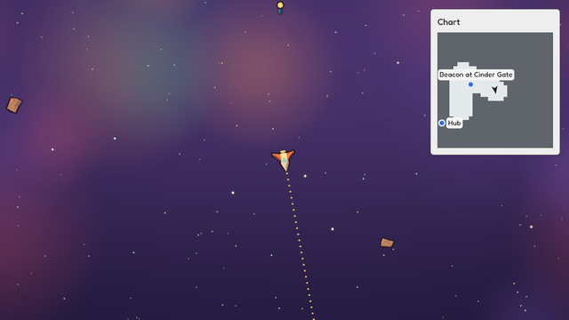

# Map and fog

How a thing remembers where it has been, and how a screen shows that memory as a map
under fog of war. The code is `crates/api/src/explored.rs` (the cells and their text),
`crates/sim/src/explore.rs` (the explore service and its checks), `ctx.explored` in
`crates/script/src/host.rs`, `ui.map` parsing in `crates/script/src/screens.rs` and
painting in `crates/view/src/screens/map.rs`.



## Trying it

From `engine/`, with the engine installed (`modules-and-install.md`):

```sh
galaxy-gm check tests/play/map/chart
galaxy shot --modules tests/play/map --ticks 420 --out chart.png
galaxy play --modules tests/play/map          # M hides the chart; the arrows fly by hand
galaxy sim run --modules tests/play/map --ticks 300 --state --entity chart.ship
```

A ship flies a route by itself inside one place, the reach, as a game's open area
would. From the first tick it remembers the ground within 24 units of it; the chart in
the corner follows it, with that ground clear and the rest under fog. Rocks show on the
chart once flown near; the hub and a beacon are always shown, clamped to the edge while
off the chart, and the beacon's long label flips to its left near the edge. A crate in another place, the dock, never shows, though its coordinates fall on
explored ground. M closes the chart, which fades out still showing the ground.

## Memory

A module puts `engine.explorer { radius }` on any thing. After the tick's other services
(flight, motion, walking, collide, ground, the cadence and settling holds), the explore
service marks, for each explorer, the grid cell under it and every cell whose centre is
within `radius` of it, into `engine.explored { cell, cells, place }` on the same thing,
making that component the first time. `cell` is the cell size in world units
(default 8); a module that wants another size puts `engine.explored { cell = 4 }` in its
start state. Changing `cell` later reinterprets the cells, so clear them with it.

`cells` is canonical text: rows of runs, `y:x+count,x+count;y:...`, rows by ascending
cell `y`, runs by ascending cell `x`, each count at least 1, runs never touching.
`0:-2+5;1:-3+7` is cells -2 to 2 on row 0 and -3 to 3 on row 1. A cell is
`(floor(x / cell), floor(y / cell))` in plain IEEE arithmetic and the distance test is
plain multiplication and addition, so the same positions mark the same cells, bit for
bit, on every OS. One set of cells has exactly one text, so the same memory always hashes
the same, and a ship's path through open space becomes a few runs a row: a memory grows
with the rows the path crosses, not with every cell.

Because the memory is a component, it is saved, loaded, hashed, replayed and edited like
everything else, and `galaxy sim run --state` shows it.

**Cheap per tick.** Parsing the text every tick would cost more as the memory grows. The
session keeps each explorer's memory decoded, with the text it was decoded from. Each tick
it compares that text with the world's (a memory compare) and decodes again only when they
differ: after a load, a hot-load, an edit or a script write. Marking checks the few cells
round the explorer; only a tick that uncovers a new cell re-encodes the text and writes
the component, with the cause `explore`. A ship sitting still writes nothing.

**Places.** Places have their own coordinates (`places-and-beings.md`), so a memory is of
one place: `place` names it, empty for the open plane. The service makes the memory in
the place its explorer is in, and marks it only while the explorer is in that place; a
ship flying in a game's open area (itself a place) records in that place's coordinates,
and the same ship docked in a station room records nothing there, keeping its memory for
when it flies out. Cells from one place therefore never show in another. A memory with
no cells (new, or cleared by an edit) moves to its explorer's place on the next tick. A
module whose explorer starts somewhere else than the place it should remember puts
`engine.explored { place = "<that place>" }` in its start state. `place` must name an
`engine.place`, and that place can't be removed while a memory names it. One memory per thing keeps saves and edits simple; a thing that should
remember several places needs one explorer-and-memory thing per place, which modules can
already make.

**Guards.** `cell` must be at least 0.25 world units and `radius` at least 0, and the
radius may span at most 64 cells (a radius meant in cells, or a tiny cell, would mark
thousands of cells a tick). A malformed or non-canonical `cells` text is refused with the
reason (`run ... touches the run before it; join them`). These are checked when the start
states load, when a save resumes, and on every batch (script, input or edit) that writes
`engine.explorer` or `engine.explored`, so the bad write is refused and nothing changes;
`galaxy-gm check` reports a bad start state.

**Setting it.** Tests set memory at once with edits (`world-edits.md`): `set <ship>
engine.explored cells="0:0+4;1:0+4"` sets it (add `place=<place>` when it is of a place),
`put <ship> engine.explored` clears it (the explorer marks round itself again next tick,
in the place it is in), and an `[[edit]]` with `put = { cells = ..., place = ... }` does
the same in a scenario. A script with `engine.explored` in its `writes` can do the
same with `ctx.patch`.

**Reading it.** `ctx.explored(entity, x, y)` says whether the point, in the memory's
place's coordinates, is in a remembered cell; false when the entity has no memory. It is charged to the step budget by the length
of the text.

## The map

`ui.map { id, width, height, span, memory, follow | center = { x, y }, marks }` is a
screen widget (`screens.md`). It shows one place: the followed thing's (else the
memory's, else the open plane). The screen's Luau returns it once; Rust reads the followed
thing, the marks' positions and the memory from the world every frame and paints:

- a frame of `map_edge`, and inside it the ground as tiles: each row of cells in view is
  cut into its explored runs (`map_clear`) and the fog between them (`map_fog`). A memory
  of another place shows as fog;
- each mark in the map's place whose cell is explored, or every `always` mark in that
  place (clamped to the edge when off the map), as a dot of `map_mark` (or its look's
  fill) or a module icon, with a ring of `map_clear` so it reads on fog too, and an
  optional label on a tag. The tag sits right of the mark, or left of it when it would
  cross the map's right edge, and is always kept whole inside the map;
- the followed thing as a dart (`PanelShape::Dart`: a long arrowhead with a notched
  tail) turned to its heading, with its own ring. A near-equilateral triangle read
  backwards at a glance; the long tip and the notch can't be mistaken for each other.
  It is drawn in a layer of its own over the rest, so no label hides it.

It all goes in a layer clipped to the map, after its parent's surface, so it scrolls,
slides and fades with its screen; a closing screen's map keeps reading the world while it
fades out. Frame and ground tiles are `PanelShape::Tile`: the renderer puts their edges on
whole physical pixels, so neighbouring tiles meet with no seam and no overlap at any
display scale, and the map fades evenly instead of showing lighter lines where
translucent rectangles overlap. Each dot and the marker is one panel with its ring as
its border, so it fades as one. The decoded memory is kept per entity and re-read only
when the text changes. The map has no Luau-visible state, so notes, audit and films redraw
it from the replayed world exactly. Marks and the heading marker need 3:1 contrast on
`map_clear`, and fog 1.5:1 against it; the style check refuses less.

## Alternatives and why this design

- **Memory outside the world** (in the view, or a side file). Cheaper to write, but it
  would not be saved with the game, replayed, edited by tests, or seen by scripts, and two
  views of one session could disagree. As a component it gets all of that for free.
- **A list of cells, or a bitmap.** A list of cells is simple but grows with every cell
  and is large in saves and hashes; a bitmap needs bounds the open plane doesn't have.
  Runs per row are compact for paths and areas, cheap to test a point in, and have one
  canonical spelling.
- **Positions as breadcrumbs** (the memory is the path; the map draws circles round it).
  Smaller for straight flights, but every point test and every frame would walk the whole
  path. Cells make both a lookup.
- **A Luau rule marking memory on the cadence.** Per-tick work belongs in Rust, and once a
  second would leave gaps at speed.
- **The map as screen widgets** (a Luau function emitting a cell grid). The screen would
  re-run whenever anything moved, which the screen contract forbids, and hundreds of
  widgets would hit the 512-widget cap. Painting in Rust from the world keeps screens
  event-only.
- **A drawn heading arrow icon.** Panels already draw rotated shapes, so the marker
  needs no art, turns smoothly and fades as one panel.
