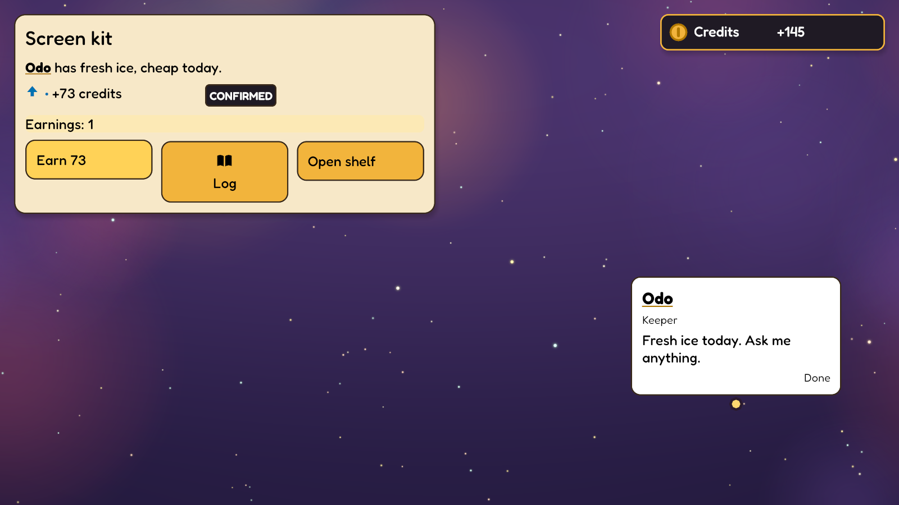
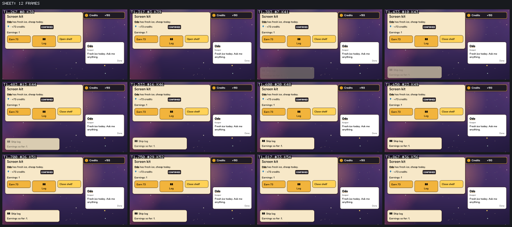

# Screens

Screens are pure Luau functions returning engine-owned widget trees. An entry script
listed in `manifest.toml` may return `screen = function(ctx, ui) ... end` alongside its
event handlers. `nil` hides that screen. All screens run in module ID order, then manifest
script order. Later widgets paint above earlier ones.

```lua
return {
    screen = function(ctx, ui)
        local state = ctx.get("state", "counter")
        return ui.panel { width = 360, children = {
            ui.text { text = "Count: " .. state.value },
            ui.list { children = { ui.text { text = "First entry" } } },
            ui.button { text = "Add one", on = "increment", payload = { amount = 1 } },
        } }
    end,
    on = {
        increment = function(event, ctx)
            local state = ctx.get("state", "counter")
            ctx.patch("state", "counter", { value = state.value + event.payload.amount })
        end,
    },
}
```

Declare `increment` in the module's events and `counter` in its components. A screen's
context has only `module`, `get` and `query`. The host tracks both component reads (including
absent components) and query membership. Rust compares these reads with the world and
calls Luau again only when they change. Resizing, moving anchors and drawing frames run
in Rust. There is no tick, random stream, mutable context or memory between calls. A
fresh budgeted VM enforces the normal script limits; trees allow 512 widgets and 32 levels.
Hot loading replaces the functions and caches. Failures show in the view's problem panel.

Each screen owns an immutable snapshot of its module files. Fresh calls share that
snapshot and compiled bytecode by reference; they never copy the module's models,
icons, data and sources per refresh. Only host-owned immutable input is shared: the
VM, required tables, closures, upvalues and budgets are still fresh on every call,
including failed calls. No script case uses a persistent VM. Hot loading constructs
new screens with the new snapshot; replay, film and audit use their embedded files.
Within a refresh, each component read is copied once for dependency tracking. Repeated
`ctx.get` calls still return independent Luau tables and charge the same step budget;
mutating a returned table changes neither another read nor the tracked world snapshot.
If changed reads produce the same widget tree, the view retains its text measurements;
the tree's layout and paint still run against the current viewport and anchors.

### Measuring screen cost headlessly

The opt-in `screen_cost` test in `crates/view/tests/screen_cost.rs` measures all screen
refreshes separately from a complete `View::scene` call on each simulated tick, without
a window or GPU. Set `GALAXY_SCREEN_MODULE` to a module folder,
`GALAXY_SCREEN_INPUTS` to an inputs file containing only `[[input]]` events
(without scenario expectations), and `GALAXY_SCREEN_TICKS` to the run length. `GALAXY_SCREEN_SEED`
defaults to 7; `GALAXY_SCREEN_FROM` defaults to 31, excluding startup and text-cache
warmup. Set it later to measure a particular part of a journey. From `engine/`, run:

```sh
cargo xtask cargo test -p galaxy-view --test screen_cost --release -- --ignored --nocapture
```

The report gives screen and scene milliseconds (median, p95 and max), screen call
count, final world hash and a fingerprint of every frame's overlay. Compare fingerprints
with the same engine/toolchain, module, inputs, seed and tick range. These measure CPU
scene construction; they do not measure GPU drawing or window scheduling stalls.

## Layout and readability

`crates/script/src/screens.rs` parses the tree. `crates/view/src/screens.rs` measures,
places, checks, paints and hit-tests it. `galaxy-gm types` describes the screen API.

- `text` and `button` have `text`; buttons also require a declared local `on` event and
  optional JSON `payload`. `panel`, `list` and `column` flow children down; `row` flows
  them across. `children` is a consecutive list of widget tables, starting at 1; a lone
  widget, named entries or gaps fail with a `children` error instead of dropping content.
  Malformed fields report their names. `id` labels diagnostic paths and bot targets.
- `width`, `height`, `pad`, `gap`, `size`, `x` and `y` are logical pixels. Available width
  is inherited; row children share the width left after fixed widths and gaps. Height
  comes from content unless explicit. Defaults: 20px text, 12px gaps, and the style's frame padding
  on panels/buttons (16px in the neutral default). `x` or `y` makes a child explicitly placed instead of flowing.
- Text is shaped and wrapped headlessly by `galaxy_render::text::TextMeasure` with the
  same bundled Fredoka font and metrics as glyphon drawing. The module owns colours
  through `[screen]` in `style.toml`; invalid contrast is refused before drawing.
  Text outside a containing panel gets its own flat paper surface, including root text,
  columns and labels anchored away from their parent. Authors need no extra wrapper.
- Readability findings name the module, script and widget path. They cover text below
  16px, missing glyphs, empty labels, text outside its box, small button targets (44px),
  widgets outside the viewport or parent, sibling overlaps, overlaps of painted widgets
  from separate screens, and missing anchors. Overlap findings name both widget paths.
  Unknown properties and undeclared button events fail parsing at their widget path.
- `align` places a widget against the window's edges instead of its parent's flow:
  `top-left`, `top`, `top-right`, `left`, `center`, `right`, `bottom-left`, `bottom` or
  `bottom-right`. `x` and `y` are then margins from those edges (offsets from the middle
  on a centred axis), and the widget keeps its own width and height. A status panel at
  `top-right` stays in that corner at any window size and display scale, so play, bot
  runs, audit and film measure viewport problems against the size actually drawn. A
  widget is anchored or aligned, not both, and grid cells flow.
- `galaxy-gm check` runs the module's screens after the first tick at 1280x720, without a
  GPU, and then presses (below). Branches it can't reach are checked while playing.

### Pressing in check

`crates/view/src/presses.rs`: from the first tick, and with the player moved into each
place, check presses every visible button and `ui.target` (not talk bubbles, which have
their own check), two presses deep. A press is an ordinary input through a `Session`:
the module's handlers run, a trip they start lands as play would land it, and one quiet
tick follows. Each new screen state, with talk silent, gets the same readability checks
as play, life name signs included, so a sign under a room panel or a list a script opens
is a `press` finding such as ``place `demo.hall`, after pressing `open`: demo.host/sign:
overlaps demo:scripts/main.luau/screen/list[2]``. A handler that fails on a press is a
finding too. States are told apart by what is on screen and by what event handlers
changed (fields a handler set to something other than the start world, and start
components removed), so a press that only moves a page counter or a selection still
gets its second press; a screen already checked is not reported twice. A screen's
identity includes each drop target's verdicts and notes, so a press that rewrites only a
note leads to a new screen whose problems are reported. Changes from the
cadence and engine services don't count, so they can't split one state into many. At
most 32 new states per start are explored, and check's `pressed` output lists the states
per start and whether that cap stopped it. Keys, drags, scrolls, three presses deep, talk answers and clock changes
are not pressed: those states need a test or a recorded run. The pressed worlds are
copies; the module's own state is untouched. `tests/play/sign-panel` opens a list over a
name sign from a button and must fail check; its first screen alone passes.

Each painted widget contributes one ordered panel/text layer between the base overlay
and engine chrome. GPU buffers and glyphon renderers grow to the required layer count.
This preserves panel/text/panel/text order at arbitrary nesting depths; grouping all
panels before all text would incorrectly show covered labels. Hit testing walks the
same order backwards, so an opaque panel also blocks a covered button.

## Named anchors

`engine.anchor { name, target, x, y, height }` publishes `publisher#name`. `target` is the
entity followed; empty follows the publisher itself. Offsets are in world units in the
target's rotated frame. Multiple named anchors use separate publishing entities pointing
at the same target. Modules can publish these in start data, or write them with the
`engine.anchor` capability.

A widget with `anchor = "marker#label"` is detached from flow. The view interpolates the
target's pose, projects it through the current camera, places the widget above that point
and clamps it to an 8px viewport margin. `x` and `y` offset that placement. This is generic:
the publisher need not have a model. Rooms additionally publish `place.<full-id>`, `spot.<name>`, `being.<full-id>` and
`being.<full-id>.<node-name>` through this same map; see [Rooms and travel](rooms-and-travel.md).
A missing target or projection reports a missing
anchor rather than silently discarding the widget.

**Yielding.** `yield = true` on an anchored widget makes it give way instead of being
clamped: it isn't drawn while its anchor is off screen or unpublished (no missing-anchor
finding), while it would leave the window (the same 8px margin), or while any of it would
overlap another painted widget, from any screen, a talk bubble or a life sign. Yielding
widgets are decided after every screen is laid out and scrolled, in paint order, and
each one shown is in the way of later ones, so two name labels never cover each other
either. A hidden widget paints nothing, takes no click, is no bot target and is left out
of the readability and overlap checks, so play reports no overlap. A trader's name label
can then show at any distance and zoom and simply not be drawn over the status panel
(`tests/play/ambient`, `view/tests/ambient.rs`). Fading instead of hiding would need a
remembered opacity per widget, which notes, audit and film would have to replay; hiding
is decided afresh from each frame's layout.

## Clicks, recording and trying it

Left click hit-tests the displayed tree in logical pixels. The chosen button becomes an
ordinary input with source `ui`, its event name and payload, applied on the next tick.
The world changes only through recorded events. Open/closed screens are derived from recorded world components, so
audit and film reconstruct them from the embedded module files and replayed world. Anchor
placement uses the note's existing camera, size and interpolation metadata. No screenshot
or live VM state is used to reconstruct a screen. Notes also keep the last drawn scroll
offsets and active drag; audit restores them before layout.

The bot takes `[[click]]` entries with `tick` and either `x`/`y` or `widget` in an inputs
file. `widget` is a full diagnostic path or a unique `id`, including on a root button.
It also accepts `point:x,y`, equivalent to the finite logical-pixel `x`/`y` fields.
It lays out the current world before that tick, resolves the widget's current centre
(including moving anchors), and uses the same hit test. Missing or ambiguous names,
non-buttons and covered centres fail the run. Recordings still contain the normal `ui`
event and payload; replay does not repeat the lookup. Use `galaxy play` for pointer
instructions, in a window or `--headless` (no window, as fast as the machine goes, laid out
at `--size` and `--scale` as a window would be), then replay or film its recording. Other
headless input runners (`shot`, `film`, `sim run`) refuse pointer instructions because
they do not play a screen.
`galaxy-gm guide screens` gives a complete standalone authoring and playtest recipe;
`galaxy-gm fields inputs` lists both click forms.

From the repository root, with a dev build installed:

```sh
galaxy --build <name> play --modules engine/tests/play/screens
galaxy --build <name> play --modules engine/tests/play/screens --inputs engine/tests/play/screens-inputs.toml --ticks 70
galaxy-gm --build <name> check engine/tests/play/screens-unreadable
galaxy --build <name> sim replay <session>/recording.json
galaxy-gm --build <name> audit <session>/recording.json
galaxy-gm --build <name> film <session>/recording.json --from 25 --to 26 --out screen-film
```

The first button increments a counter; Hide closes the screen and Space opens it again.
The label follows a moving marker without invoking Luau. The unreadable module deliberately
fails check. The bot adds one, takes a note, hides and reopens the screen, then takes another
note. Headless tests exercise those contracts; GPU draw-order tests are explicitly ignored.

Pure functions were chosen over persistent UI VMs or imperative open/close commands so
replays, hot loads and checking share the same result. A full immediate-mode Luau UI would
run scripts per frame; storing every widget in the world would contaminate simulation
history with layout. Neither is needed for these widgets.

## Grids, scrolling and deltas

`ui.grid { columns = 3, children = {...} }` lays out equal-width cells in rows, each row
as tall as its tallest cell. Cells flow without anchors or x/y; explicit cell widths
still obey containment and overlap checks. `ui.scroll { id, height, children, on?, payload? }`
flows a vertical list in a fixed viewport. Rust clamps its offset, clips all descendant
panels and glyphs using the same GPU scissor, and clips hit testing. A minimum 12px inner
padding keeps rows clear of the frame. A separate lane (`handle_width`, default 32px) plus an 8px gap holds the
scroll track; none of its grab area covers content. The thumb is at least `handle_min` (default 44px) tall;
a shorter track is a readability finding. Dragging preserves the grab point, captures the
pointer outside the track and releases on mouse-up. Clicking the track centres the
thumb there. Both routes emit the same offset event as wheel scrolling.
The wheel over a list scrolls it; elsewhere it zooms the camera. Nested lists use the
innermost one under the pointer. The full content is measured and checked headlessly,
including entries currently outside the scrolling viewport. Viewport clipping is allowed;
clipped text inside its own widget, unreadable cells and overlapping entries still fail.

`ui.delta { value = -12 }` displays a signed number in the style's loss or gain colour on
the containing surface or paper. The sign carries the meaning as well as colour. Dimensions and the 16px minimum
are the same as text. `ui.icon { icon = "token" }` resolves a local module name from:

```toml
# icons.toml
[icons]
token = "T"
```

A glyph icon is a string, embedded with the module in recordings. The GM checks all
declared glyphs against the actual bundled font, including unused declarations, and
reports any referenced icon missing from the catalogue. Drawn SVG icons are under
"Looks, spans, drawn icons and UI motion" below.

## Dragging and view state

```lua
ui.grid { columns = 2, children = {
    ui.drag_source { id = "token", text = "Small token", value = "small" },
    ui.drop_target { id = "slot", text = "Slot", on = "place",
        accepts = { small = "", large = "Needs a wider slot" },
        notes = { small = "Fills the slot: 1 left" } },
} }
```

A source has a string `value`; every target maps values to verdict strings in `accepts`.
An empty string permits the drop, a nonempty string explains rejection, and an absent
value means "Not accepted". Picking up immediately colours every target and shows its
verdict in words on a softly tinted surface. An optional `notes` maps accepted values to
what that drop will change, drawn on a line under `Drop here`. A consequence that never
refuses (a cost, a slowdown) then shows at pickup beside the refusals, without Luau
running during the drag. A note must belong to a value the target accepts, and is
nonempty text; anything else is a screen error. Layout reserves the largest measured
verdict or note, so targets never move when picking up. Pickup records each target's
reserved height in the drag, and layout keeps it until the drop, so a note a script
rewrites mid-drag (a cost that changes) moves no target either. A label that outgrows
the kept space is a `drop verdict is clipped` problem rather than a move. The record is
part of the presentation, so notes and replays rebuild the kept layout. All verdict and note labels
receive glyph and readability checks. Picking up lifts the actual source surface and label, leaving an
empty socket. Its size and pointer grab point stay attached to the pointer. Release on
an accepting target sends its `on` event with its `payload` plus `value`; release elsewhere
or on a rejecting target returns home. Both use a 240ms smoothstep settling animation,
computed from simulation tick and interpolation, independent of frame rate.

A target may contain children above its verdict label. Keep a fixed-height child area
for its occupant so empty and occupied slots have the same geometry. The event handler
stores the placement in world state; the screen then emits the source under its new
parent, with the **same id and value in the same screen script**. This identity lets Rust
suppress the new copy while the lifted token animates into its new box, and lets the
player pick it up there again. IDs for movable sources must be unique within that
script. The rich-screen demo shows this pattern, including occupied-slot rejection.
A source removed or changed by state updates cannot complete its old drag. Targets use the
current tree, and modules should validate world operations in their event handlers.

Scrolling normally changes only presentation. An optional scroll `on` sends a recorded
input with `payload` plus the new `offset` in logical pixels, only when the clamped offset
changes. Thus a module that changes the world when scrolling replays that change exactly.
Drops always use recorded inputs, just like clicks. Neither gesture invokes Luau per frame.

`Screens::Presentation` keeps scroll offsets by full widget path, plus the source,
value, stable identity, original bounds, grab point and pointer position of an active
drag, a captured scroll thumb, and a settling token with its start time. Played frames
record changed presentation snapshots separately from simulation inputs. World replay ignores those
snapshots; film applies them on their recorded ticks. Notes keep their own exact last
drawn snapshot in `Moment`, so a pointer move arriving before F8 cannot alter the note's
redraw. Audit restores that snapshot. Filming around a selected note prioritises that
snapshot at the note's tick. Notes without screen metadata default to an unscrolled
view with no drag. Recordings with the earlier experimental screen metadata are refused with a message to use their
original build; current screen snapshots carry presentation version 1.
Hot loading resets widgets and their state. This keeps presentation out of world hashes
and saves; storing only a drop would lose unfinished drags, while invoking Luau every
pointer move would break the event-only screen contract.

The bot uses `[[pointer]]` entries with `tick`, `action` (`pickup`, `move`, `drop`, `scroll`),
`widget` (a unique ID or full path) and optional `delta` (scroll pixels, positive down).
Separate pickup and drop ticks allow mid-drag notes. Targets must be visible at their
centre and uncovered. `entries::thumb`, `entries::track-start` and
`entries::track-end` name scrollbar parts for pickup/move/drop using the same captured
pointer path as live input. Gestures run before clicks at the same tick; both run before world
inputs. A play run with scripted pointer gestures ignores live pointer and focus
changes for those gestures; F8 editing remains interactive. Headless sim/shot/film
input runners refuse gestures; play them once and then
replay or film the resulting recording. Help, `fields inputs`, `types` and `guide screens`
cover this surface.

From the repo root:

```sh
galaxy --build <name> play --modules engine/tests/play/rich-screens
galaxy --build <name> play --modules engine/tests/play/rich-screens --inputs engine/tests/play/rich-screens-inputs.toml --ticks 80
galaxy-gm --build <name> check engine/tests/play/rich-screens/rich
galaxy --build <name> sim replay <session>/recording.json
galaxy-gm --build <name> audit <session>/recording.json
galaxy-gm --build <name> film <session>/recording.json --note 2 --before 0 --after 1
```

The generic module offers sixteen entries, two token sizes and two slots. The bot
scrolls, notes the list, picks up the large token, notes its rejection at the narrow
slot, and drops it into the wide slot. Headless tests compare rebuilt overlays at each
note and world hashes after replay. GPU clipping tests are explicitly ignored.

`tests/play/rich-screens-motion.toml` drags the thumb, returns a token from a refusing
slot, places it in an accepting slot, then picks it up again and returns it to that
slot after another refusal. Run it for 140 ticks, audit its eight notes (including
settling frames), and film ticks 1 through 134 to inspect the actual movement with
`galaxy-gm motion sheet` and `strip`. Headless tests assert one visible token throughout,
state-driven placement, return motion, scroll events, replay hashes and rebuilt notes.

`tests/play/drop-notes` has one token and two slots that both accept it; only the far
slot has a note. `tests/play/drop-notes-inputs.toml` (90 ticks) picks the token up,
notes mid-drag, drops it on the far slot, lifts it out of there and drops it on the near
slot. Headless tests assert the note shows on the far slot only while dragging, neither
slot moves on any tick, every note rebuilds identically and the replay hash matches.
Another headless test rewrites a held value's note: neither slot moves, and a note that
no longer fits is reported.

## Talk bubbles

The talk service supplies an internal bubble widget from recorded world components:
a column of heading, subtitle, line, and a Continue/Done marker or a row of answer
buttons, sized by the `[screen]` `bubble_*` keys.
It uses this same measurement, layout, anchor, clipping, ordered paint and hit-testing
path, with the screen style's bubble surface. No separate talk look is encoded. Module-owned
width and offsets affect its geometry. A whole bubble is a click target (hit
testing does not descend into its texts); its input includes the current line so stale or
duplicate advances are recorded no-ops. A bubble with answers is not itself a target; its
buttons are. Speaker picking runs only when no
painted widget covers the pointer. See [Talk](talk.md) for focus checks combining screen
surfaces, room geometry and each authored line.

Life signs are internal anchored text widgets with the screen style's sign surface. Resting
signs show name and activity; moving signs show the name, which joins the bubble while
speaking. Directories use ordinary screen queries over life, being and location fields.
No separate sign paint or game look is introduced. See [Places and beings](places-and-beings.md).

## Module-owned screen style

`[screen]` in `style.toml` supplies the whole scene's screen look, including all
scripts, talk bubbles and life signs. As with `[sky]` and `[course]`, modules are
sorted by ID; the last one supplying this table wins, and `galaxy-gm check` reports
multiple suppliers. Tables do not merge field by field. Omitted keys use the neutral
engine default, and modules without a table work unchanged. This lets a style-only
module dress shared screen content without adding paint to its Luau trees.

`galaxy-gm fields style` is the complete field/range/default reference; `guide style`
explains authoring. For example:

```toml
[screen]
panel = "#eeeeee"
button = "#dddddd"
text = "#202020"
radius = 8.0
frame_padding = 16.0
handle_width = 32.0
handle_min = 44.0
```

The colour fields are `paper`, `panel`, `button`, `text`, `gain`, `loss`, `border`,
`bubble`, `sign`, `held`, `socket`, `accept`, `refuse`, `resting`, `track`, `handle`,
`handle_active` and `highlight` (the outline of a hovered target's model). Surface and text colours must be opaque: the arbitrary world behind
them cannot undermine contrast. Linear-sRGB luminance checks every text/gain/loss
against every possible text-bearing surface at 4.5:1, including nested deltas and
both drag verdicts. Both handle states must contrast with the track at 3:1, and a
dashed resting frame's `border` its `resting` fill. Failures
name `[screen]` and both fields. An invalid table never reaches painting; playing
shows its diagnostic and uses the last valid supplier or the neutral default.

Talk bubble text sizes are `bubble_title` (16-40), `bubble_subtitle`, `bubble_text` and
`bubble_marker` (16-32), with `bubble_title_weight` (400-700). Sizes are logical pixels:
`radius` and `handle_radius` (0-24), `border_px` and
`hint_border_px` (0-4), `highlight_px` (2-12), `frame_padding` (12-32), `target_min` (44-64), `handle_width`
(24-48), `handle_min` (44-80), `socket_dash` and `resting_dash` (0-16; zero is solid).
Non-finite or
out-of-range values fail check. `target_min` is a checked floor for actual targets,
not a resizer. A scrolling viewport must fit the minimum handle. Explicit widget
`pad` overrides default frame padding; scroll content retains its minimum 12px inset.
Corners and borders are capped by the widget padding to keep paint out of its text.
Standalone text and signs have a flat opaque backing covering every glyph. A surface
casts a soft shadow only when its look sets `shadow`.

The engine still measures and places the tree, clips and hit-tests it, captures the
pointer, reserves verdict space, and performs the same 240ms drop/return animation.
Changing sizing fields changes spacing through those same rules; changing paint
alone leaves every box and gesture unchanged. No style field enters world state.
`--watch` reloads it through the normal asset path. A style-only reload records the
new files with `presentation_only`, without a hot-loaded simulation fact; older
recordings retain their original hot-load semantics. Audit and film use those embedded
files, including changes during a session, rather than today's module folder. Each
note also keeps its effective screen style, so notes on either side of a reload
within the same simulation tick retain the exact paint they showed.

From the repository root, these two modules have identical files except their style:

```sh
galaxy --build <name> play --modules engine/tests/play/screen-light
galaxy --build <name> play --modules engine/tests/play/screen-dark
# Repeat for each module:
galaxy --build <name> play --modules engine/tests/play/screen-light --inputs engine/tests/play/screen-style-inputs.toml --ticks 140
galaxy-gm --build <name> check engine/tests/play/screen-light/styled
galaxy --build <name> sim replay <session>/recording.json
galaxy-gm --build <name> audit <session>/recording.json
galaxy-gm --build <name> film <session>/recording.json --from 1 --to 134 --out <film>
galaxy-gm --build <name> motion track <film> --thing styled.marker
galaxy-gm --build <name> motion sheet <film> --count 12
galaxy-gm --build <name> motion strip <film> --screen "300,240;900,240"
galaxy-gm --build <name> motion flow <film> --screen --region 300,150,600,400
galaxy-gm --build <name> motion flicker <film> --screen
```

Drag the scroll handle, drop a large token on the refusing narrow slot, then on the
accepting wide slot, and pick it up there again. The moving marker's bubble uses the
same style. The bot leaves eight notes covering the drag, hints and both settling
paths. Matching geometry settings make both runs' boxes, inputs, presentation snapshots
and world hashes identical while their paint differs. Existing screen fixtures use
the neutral default. Headless tests reconstruct all notes and exercise style reload,
invalid contrast/sizing and module order. GPU tests remain opt-in.

A table in the existing style asset avoids a second loader, watch path or recording
store. Per-widget colours would duplicate the look in every script and make whole-theme
contrast checks impossible without enumerating runtime branches. Skin scripts or
module-owned motion would move frame work into Luau and change the shared behaviour.

## Looks, spans, drawn icons and UI motion

A module dresses screens through its style, never through colours in Luau. Named looks
sit beside the base table:

```toml
[screen.looks.chip]
fill = "#1f1a24"
text = "#ffffff"
border = "#f2b43c"
radius = 12.0
shadow = 6.0

[screen.looks.name]
weight = 700.0
underline = "#b07800"
```

A look has `fill`, `text`, `border`, `border_px` (0-4), `radius` (0-24), `pad` (0-32),
`shadow` (0-16 px), `hover` (a button's fill under the pointer), `weight` (300-700),
`underline`, `gain`, `loss`, `flash` and `mark`. Every key is optional and falls back to
the base table. A widget picks one with `look = "chip"`. A frame (panel, button, bubble,
scroll, drag source, drop target) paints the look's surface. Text whose look has a fill
becomes a tag that hugs its words. Other text keeps the surface it sits on and only
changes ink, weight or underline. `bubble_look`, `bubble_title_look` and `sign_look` give
talk bubbles, their heading and name signs a look without any script. `button_hover`
fills a hovered button.

`spans = { "Paid ", { text = "120", look = "gain" } }` replaces `text` on text and
buttons. The engine shapes the parts as one text, so wrapping and alignment stay those of
one label. Each span gets its look's colour and weight. A span look with a fill paints a
tag behind its glyphs, and one with `underline` gets an underline. `mark = true` declares
a symbol such as `•` that carries meaning beside words: it needs 3:1 instead of 4.5:1 and
may hold no letters or digits.

`icons.toml` maps a name either to a glyph string, or to `{ svg = "icons/coin.svg" }`
for a drawn icon. A drawn icon is tinted with its text's ink unless `painted = true`
keeps the file's own colours. `ui.icon` draws one as a square of `size` (default 20). Text and
buttons take `icon` too, beside the words, or above them with `icon_at = "top"`. SVG
files are module text, so recordings embed them like scripts. The renderer reads a small
subset itself (`vector.rs`): paths with every command, rect, circle, ellipse, line,
polyline, polygon, groups and transforms, fill and stroke in hex or `currentColor`, and
even-odd or nonzero fill. Gradients, text, images and other elements are refused by
name, and so are `filter`, `clip-path`, `mask` and markers, which would draw from
`<defs>`. Files are capped at 64KB and 50,000 points. Icons are rasterised once
per size with 4x4 supersampling, cached by content hash, and drawn by their own small
pipeline between panels and text.

Check covers what the player sees. Each look must be readable on its own fill, its hover
and its flash. Each widget's words are tested on every background it can be drawn on:
the surface it sits on, a ready button's hover fill (its look's or `button_hover`) and
its flash at full strength. Each span's colour is tested on its tag, or else on each of
those backgrounds. Underlines and tinted icons need 3:1 on each.
Check also names unknown looks, missing or broken SVG, icons under 16px and icons
clipped by their widget.

**Motion** is presentation only. `motion_in` and `motion_out` (0-1 s) fade the outermost
panel, scroll or bubble of a script when it appears or goes away, with a `motion_slide`
(0-48 px) rise. A leaving surface is kept as its last widget tree and drawn fading where
it was, scrolled and clipped as it was; it no longer takes clicks. `hover_lift` and
`press_sink` (0-6 px) move a hovered or held button. `cue = "count"` on a delta counts from its old value to the new one over
`cue_time` (0-2 s). `cue = "flash"` fades a changed text, delta or icon from the `flash`
colour (or its look's) back to its own. Every motion key defaults to 0, so modules
without them don't move.

Motion runs on the screen clock (tick plus alpha), never on a wall clock. It lives in the
presentation snapshot, so notes, audit and film rebuild a frame mid-fade exactly. Nothing
enters world state, events or recordings, and boxes, hit tests and check use the settled
layout. A replay therefore has the same world hash with motion on or off. `galaxy play
--reduced-motion` (or `GALAXY_REDUCED_MOTION=1`) settles every motion at once, including
a released token's glide home or onto its target. It is one setting with the camera's:
the same switch turns off camera feel ([effects](effects.md)).

`engine/tests/play/ui-kit` is the fixture: a dark chip with a drawn coin and a counted
delta, a parchment panel with spans, a receipt row with a mark and a tag, buttons with
icons beside and above, a shelf that fades in and out, and a talk bubble with an
underlined name. It sits under `tests/play` because it is drawn and played.





```sh
galaxy-gm --build <name> check engine/tests/play/ui-kit/kit
galaxy --build <name> play --modules engine/tests/play/ui-kit --inputs engine/tests/play/ui-kit-inputs.toml --ticks 100
galaxy-gm --build <name> film <session>/recording.json --from 38 --to 52 --out <film>
galaxy-gm --build <name> motion sheet <film> --count 12
```

**Sound.** Hovers, presses, a resting button's refusal, drags, drops and surfaces coming
and going are also cues for module sounds, by look and kind, from `[ui]` in
`audio.toml`; see [UI sounds](audio.md#ui-sounds). Like motion, they never enter the
world, and a played session records them for an offline mix.

Alternatives: per-widget colours would scatter the theme across scripts and leave no
whole-theme contrast check. A general SVG library would bring a large dependency for
features screens don't use. Glyph icons were the earlier route, but the bundled font
lacks most symbols. Animating in Luau would put frame work in scripts and into
recordings. A wall clock would break notes and films.

## Edges instead of a viewport size

`align` was chosen over passing the window size to `ctx`: a size in the context would be a
tracked read, so every resize would call Luau again and authors would redo edge
arithmetic in each script. Alignment keeps resizing in Rust, beside the anchor
placement, and the readability checks see the same rectangles at every size.
`crates/view/tests/targets.rs` lays the generic fixture out at 1280x720 and 1024x576 and
checks the three edge widgets against both.

## Hovers and recorded point inspection

Every widget accepts `hover = "A label"`. `ui.hover { id = "help", anchor =
"being.demo.person", text = "Click to talk" }` declares a label for an anchored thing
without painting a permanent widget or adding a world component. Keep it conditional
on the visible place. Existing named-anchor forms work; `being.<id>.<part>` restricts
a model hover to that mesh part; an empty model node uses a 44px anchor target.
Container labels also apply to descendants without their own hover. Entity IDs resolve longest first. The last matching
declaration wins. Life signs and talk bubbles sharing the anchor use its declaration
too; an explicit widget hover takes precedence.

Rust picks the topmost clipped screen surface first, then the nearest front-facing
posed mesh surface. Model-less anchors have a 44px target at their projected point;
foreground geometry blocks them. The tooltip appears immediately and clears on
pointer exit, focus loss, drag/scroll capture or a travel cut. It follows interpolated
anchors without calling Luau per frame. Its paint uses `[screen]` text/paper, padding,
radius and border, with the same bundled font and contrast checks.

The engine owns the 320px maximum width, wrapping and placement. It tries positions
around the target and nearby readable widgets, keeps an 8px viewport margin, and
avoids text, controls, signs and speech bubbles. Empty panel paper is usable space.
If no candidate fits, the report names covered widgets; empty labels, missing glyphs
and viewport overflow are also findings. Tooltips do not intercept input. Hover picking
also includes unpainted containers with labels; input hit testing only includes painted
surfaces, so adding a container hover cannot cover a button or speaker.

`check` collects a `hovers` array from every staged scene: initial screens, rooms,
talk lines and life poses. Entries name the place, active talk line, widget, entity,
being, part, point, scroll offsets and the hover's text, bounds and readability.
Null means no authored label. Rectangle partitions find exposed widget areas even
when centres are covered. Each descendant is scrolled through its ancestors without
events. Mesh triangle probes fall back to logical pixels for partly covered parts.
Repeated target/text/talk/readability observations merge. This covers authored states,
not arbitrary future script branches.

**Keeping the part scan fast.** A named part's point is the first, in a fixed order (the
part's triangle centres, then each logical pixel of its screen bounds, row by row), that
no hovered widget covers and whose ray picks the part: the nearest front face over every
visible posed mesh is one of the part's triangles. `check` stages thousands of scenes
(every talk line of every life pose), and casting each ray against every triangle took
most of its time, so three things cut the work without changing a single point found
(`view/src/hovers/check.rs`):

- *Sure misses are skipped.* Each posed mesh has padded bounds in its own space; a ray
  that misses them isn't tested against its triangles. A ray that hits none of the part's
  own triangles can't pick it, so it skips the full nearest-hit search.
- *Triangles by screen tile.* Per set of poses, each mesh's triangles are binned into
  32-pixel screen tiles by their projected, padded corner bounds. A triangle with a corner
  behind the camera is in every tile, one off screen in none. A ray tests only its tile's
  triangles, in mesh order, so the nearest hit and its tie-break are the whole mesh's.
- *Scans are kept per set of poses.* Whether a ray picks a part depends on the camera,
  frame size and posed meshes, not on the screens; only whether a widget covers the point
  does. The view keeps each part's scan for the last 8 sets of poses (compared bit for bit,
  as the focus check does): the points that pick, runs of covered points whose rays weren't
  cast, and how far it got. A scan under other screens (the next talk line's bubble, a
  scroll offset) walks those first and only casts what it hasn't.

Tests in that file check every fifth pixel's nearest hit against the whole meshes, for the
scene camera and one inside a room, and compare kept scans with fresh ones as panels come
and go. Other options were parallel scans (they spend cores and still cast every ray) and
a bounding volume hierarchy per mesh (more code for the same cut, since rays share one
eye).

`galaxy-gm look <recording> --note 3` resolves the saved F8 pointer; `--point 320,240`
substitutes a logical-pixel point. `--tick 45 --point 320,240` uses the tick endpoint
(`alpha = 1`) at 1280x720, or `--size 1600x900`. Notes use their exact scale, size,
fractional pose and style. Divide image coordinates by the note scale. JSON returns
widget, entity, being, part, anchor, place and hover; absent values are null. No GPU
is needed. `guide hovers` and `look --help` cover this workflow.

The optional pointer lives in the existing version-1 presentation snapshot; old
snapshots default to none. F8 freezes the last drawn pointer, even if another input
arrives before the note is taken. Audit and film share the same layout and picker.
There is no timer or cached target to save, and no change to world hashes or simulation
inputs. A tooltip entity or separate inspector picker would duplicate that contract.

Bot `[[pointer]] action = "move"` works without a drag. `widget` names an ordinary
widget, an anchored hover or target ID, or `point:x,y`. Repeated moves track a moving target;
moving to empty space clears it. The life and talk demos declare hovers. The recorded
motion recipe is in [Motion tools](motion-tools.md).

## Resting buttons

```lua
ui.button { id = "add", text = "Add one", on = "add",
    resting = if full then "The tray is full: empty it first." else nil }
```

A button with `resting = "<reason>"` is an action that exists but can't happen now. It
keeps its place and size, so nothing moves when it wakes, and is drawn with the `[screen]`
`resting` fill (unset, the `panel` colour) and a frame dashed every `resting_dash`
pixels in `border`, at least 1px wide. Its text keeps the full-contrast `text` colour:
resting is never greyed out. Check refuses a style whose resting look can't be told from a
ready button: a dashed frame must contrast with the fill at 3:1, and a solid one
(`resting_dash = 0`) needs a fill other than `button`. Text on `resting` gets the usual
4.5:1 check. The frame is capped by the padding like any border, so check also refuses a
resting button whose `pad` is under 1px. Only buttons rest, and the reason must not be
empty.

Hovering shows the reason, after the button's own `hover` label if it has one; check's
`hovers` array and `look` report it like any label. A click on it hits it (it still
covers what is behind it) and records nothing, and the pointer stays an arrow. Check
never presses it. A bot `[[click]]` that lands on one, by name or point, is not
clicked: `galaxy play` prints `<widget>: resting: <reason>`, lists
`{ tick, widget, resting }` in its report's `resting_clicks` and plays on, and the
GM's `bot` report copies that list. Headless callers of `bot_click` get the same text as
an error. Replays never see the lookup, so they are unchanged.

From the repository root, with a dev build installed:

```sh
galaxy-gm --build <name> check engine/tests/play/resting/demo
galaxy --build <name> play --modules engine/tests/play/resting --inputs engine/tests/play/resting-inputs.toml --ticks 75
galaxy --build <name> sim replay <session>/recording.json
galaxy-gm --build <name> audit <session>/recording.json
```

The tray holds two. Empty rests while it is empty and Add while it is full. The bot
hovers the resting Empty, clicks it (reported, not clicked), fills the tray, clicks the
resting Add, then empties it, leaving three notes. `crates/view/tests/resting.rs` checks
the paint, hover, clicks and replay headlessly.

A flag that hides the button was rejected: the player then can't see the action exists.
Greyed text fails the contrast rules and reads as broken. A separate widget kind would
duplicate the button's layout and checks for one state.

## Clickable models

`ui.target { id, anchor, on, payload, text }` is a hover declaration that a click can
press. Its anchor uses the same forms as `ui.hover` (`being.<id>`, `being.<id>.<part>`,
`publisher#name`, ...), and the same picking: the nearest posed mesh surface under the
pointer, or a 44px box for a model-less anchor that no nearer geometry hides. A left
click on it records `on` with `payload` and source `ui`, exactly like a button, applied
on the next tick. `text` is its optional hover label. Painted widgets are hit-tested
first, so a panel or label in front blocks the click; an active drag or a travel cut
does too. A target comes before talk-speaker picking when both share a model.

While the pointer is over a target, the view lifts that entity's model by a twentieth of
its largest extent, draws its outline in the `[screen]` `highlight` colour at
`highlight_px`, and the window shows a hand pointer. The pointer is a hand over buttons,
bubbles and drag sources too. Picking uses the resting, unlifted mesh, so lifting never
moves the target out from under the pointer. All of this is derived each frame from the
presentation pointer: notes, audit and film redraw a mid-hover frame exactly, and no
world state, Luau call or timer is involved.

Bot `[[click]] widget = "<target id>"` and `[[pointer]] action = "move"` find a visible
point on the target's model through the same picking, and fail when it is covered or
off screen. `look` reports a target with a label like a hover.

From the repository root, with a dev build installed:

```sh
galaxy-gm --build <name> check engine/tests/play/targets/demo
galaxy --build <name> play --modules engine/tests/play/targets --inputs engine/tests/play/targets-inputs.toml --ticks 210
galaxy --build <name> sim replay <session>/recording.json
galaxy-gm --build <name> audit <session>/recording.json
galaxy-gm --build <name> film <session>/recording.json --from 36 --to 66 --size 1280x720 --out target-film
```

The bot glides into the hall, hovers and clicks the first figure (its camera glides to
frame it), lands that glide with a click, goes back with Esc, frames the second figure,
goes back with a right-click, shrinks the window to 1024x576 and leaves with Esc. A
painted label covers the second figure's face; clicks there do nothing. Status, key
strip and log stay at their edges throughout. `crates/view/tests/targets.rs` runs the
same journey headlessly and redraws all six notes from a replay.

A separate pickable-object component was rejected: what can be clicked depends on the
screen's state (a building is clickable from the dock view, not from inside a room),
which screens already express. A per-frame Luau hover callback would break the event-only
screen contract. Lift and outline are fixed engine behaviour; their colour and width are
module style.
