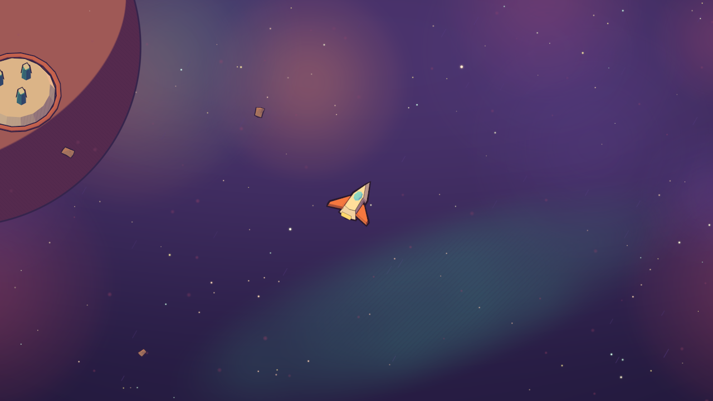
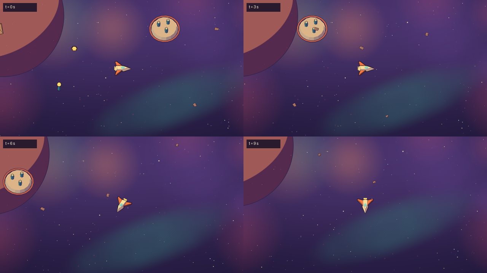
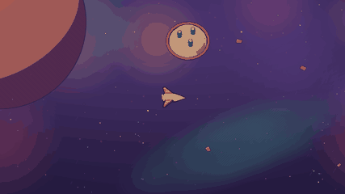

# Sky depth: layers and landmarks

How a module gives space depth: backdrop layers that slide with the camera at their own
parallax, and big shapes far away. All of it is drawn only, behind the play layer. The
code is `crates/render/src/far.rs` (what a scene holds), `crates/render/src/style.rs`
(`[[sky.layers]]` and `[[sky.landmarks]]`), `crates/view/src/far.rs` (where each one is
this frame), and `crates/render/src/renderer/far.rs` with `shaders/far.wgsl` (drawing).
The test module is `tests/play/depth/sky`.

```sh
galaxy play --modules tests/play/depth                 # W flies, Shift boosts
galaxy play --modules tests/play/depth --inputs tests/play/depth-inputs.toml --ticks 600
```

Drawn by `galaxy film` from the test module's bot at 1280x720: one frame, four moments of
the pan two seconds apart, and five seconds of it (palette-reduced).





## What a module writes

Tables in `style.toml`, from the module that owns the scene's `[sky]`. `galaxy-gm fields
style` lists every key with its range and default.

```toml
[sky]
haze = "#3d2b5e"        # what far things fade into; unset, halfway between top and bottom
atmosphere = 0.55       # at parallax p a thing fades atmosphere * (1 - p), times its fade

[[sky.layers]]          # up to 8
shape = "hatch"         # dust, speck, hatch, or model
parallax = 0.02         # 0 fixed on screen, 0.1 slides a tenth as far as the play layer
tint = "#6b4aa0"
alpha = 0.45
density = 0.35          # marks per 100 by 100 logical pixels at the camera's own zoom
size = [10.0, 18.0]     # radius, or a stroke's length, in logical pixels
angle = 60.0            # hatch strokes' direction

[[sky.layers]]
shape = "model"         # a model scattered on the layer's grid, turned at random
model = "m.rock"
look = "m.far"
parallax = 0.45
density = 0.03
size = [0.35, 0.7]      # its scale

[[sky.landmarks]]       # up to 16
shape = "disc"          # disc (a planet's limb), wash (a nebula), or model
at = [-30.0, 16.0]      # world units from the screen's centre, camera at the world origin
parallax = 0.03
size = 16.0             # disc radius or wash half length, world units
color = "#d9774b"
shadow = "#7d62b8"      # a disc's shadow band
hatch = 0.5

[[sky.landmarks]]
shape = "model"
model = "m.hub"
look = "m.far"
at = [24.0, 12.0]
parallax = 0.3
scale = 0.55
```

`galaxy-gm check` reports a key it doesn't know, a value out of its range, a shape that
isn't one of the list, `model` or `look` on a shape that isn't a model, a model shape
without a model, `alpha` on a model (models draw opaque in their own paint; fade them with`n`fade` and the atmosphere), and a model or look no module has. While playing, a model the sky
names that no module has shows in the problems panel and is left out.

## How it works

**Placement.** Everything far is placed relative to the camera's target. A landmark at
`at` with parallax `p` is drawn on the play plane at `target + at - target * p`: with the
camera at the origin it is `at` from the screen's centre, and as the camera travels it
falls back by `p` of that travel. At 0 it is fixed on screen; at 1 it stays put in the
world like the play layer. A layer's grid is offset by `target * p` the same way. Because
the far things sit on the play plane under the same camera, a tilted camera foreshortens
their motion exactly as it does the play layer's, and zooming scales them about the
screen's centre like a lens.

**Fields are drawn per pixel.** A dust, speck or hatch layer is one full-screen triangle.
For each pixel the shader finds its point on the layer's endless grid and hashes the four
nearest cells (seed, cell) into a mark: whether the cell holds one, where in the cell,
how big and how bright. A mark never grows past half a cell, so those four cells are the
only ones that can reach the pixel. There is no tile, so nothing repeats and nothing
needs wrapping: the layer is seamless however far the camera travels. Cells are sized
from `density` in logical pixels at the camera's own `view`, so a module draws the same
busy-ness whatever its world scale; zooming spreads or packs the marks.

**Landmark shapes are drawn in the shader too.** A disc is a ball lit by the style's sun
(turned into the camera's view), in the same tone bands as models, with diagonal
hatching in its shadow band and an ink rim in the style's ink. A wash is a soft
stretched blob of two octaves of value noise, lightly hatched where it is thick.

**Models are real meshes.** A model landmark, and a model layer's scattered models (the
cells in view, at most 256 a frame), are mesh instances drawn with the cel and ink
pipelines, so they keep bands, hatching and silhouette ink. They are not in the
geometry buffer, so they get no inner ink: distant things read simpler. They draw opaque,
so a model takes no `alpha`; the haze is how a far model quiets.

**Order.** Far things draw after the backdrop's gradient, clouds and stars and before
the play meshes, sorted far to near by parallax (a landmark before a layer at the same
parallax). Each group of far meshes is depth-tested within itself; after it a full-screen
triangle writes far depth everywhere without touching colour, so whatever comes next,
and the play layer, draws over it.

**Atmosphere.** Every far thing mixes its finished colour, ink included, towards the
haze by `atmosphere * (1 - parallax) * fade`. Further things sink more; `fade = 0`
keeps one crisp. Meshes carry it as `MeshInstance::haze`.

**Determinism and reduced motion.** Nothing here reads or writes the world. Random
placement hashes the world's seed, so a replay, an F8 note and a film draw the same sky,
and the world hash is the same with or without a sky (`crates/view/tests/sky.rs`). With
the player's reduced-motion setting every layer, landmark, cloud and star holds still on
screen (parallax 0); films keep the setting. Inside a room (`engine.room`) the far things
are not drawn.

**Cost.** Per pixel a field costs four cell hashes, whatever its density, and a shape
costs only its quad. On the test module's bot (`depth-inputs.toml`, 600 ticks, 1280x720,
Windows): `interval_ms` median 16.65, p95 17.9, p99 18.8 with four layers and three
landmarks, against median 16.69, p95 18.2, p99 23.2 for the same run with none: within
noise of each other at 60 fps. `scene_ms` median rose from 0.10 to 0.19 (placing the
scattered models).

## Alternatives

- **Pre-made tiles that wrap**, like the backdrop's stars. Easy, but a tile repeats, needs
  wrapping at its edges, and its marks are vertices per tile per layer. Per-pixel hashing
  costs the same at any density and never repeats.
- **Far things as real 3D depth** with a perspective camera. Parallax would come for free,
  but the flight camera is orthographic, and a module would have to place things at huge
  distances inside the camera's depth range. Placing them on the play plane by a factor
  keeps the camera as it is and the authoring simple.
- **Landmarks as models only.** A planet's limb would need a huge sphere model past the
  camera's depth range; a disc in the shader is exact at any size and keeps the cel look.
- **World units for density.** Simple, but one number then means a very different
  busy-ness in a module whose camera shows 36 units and one that shows 600.
