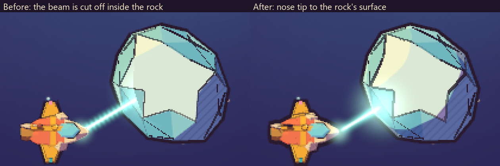

# Direction: the agreed design for the core

This is the design every change to `game/modules/core` follows. It collects what was
decided in the first slice (Lantern Reach), the station concept, the overnight brief and
three prototype labs. Those decisions used to live in GitHub issues, PRs, lab reports and
the frozen slice, where the agents building the core never looked.

**How to use it.** Before calling a change done, take screenshots at 1280×720 and put
them side by side with the reference images below. Each area says what to look for. A
screenshot that misses an agreed direction is a real defect, not a matter of taste.

**How it relates to the change list.** `known-changes.html` lists open changes on top of
this doc, from playtests of the slice. Where this doc says a later decision wins, it wins
over that list too.

**Which decision wins.** A later decision overrides an earlier one. Each area names what
was overridden, and "Superseded" near the end lists all of it. Where two sources
disagree and neither is later, the doc would list an open question for Andreas instead
of guessing; none remain. Points the sources themselves leave open are in 12.

Each area gives:

- **Decision**: what was agreed.
- **Source**: where, and when.
- **In a screenshot**: what to check.
- **Parked**: what was put off but not dropped. Don't build it unasked, and don't rule it
  out.

Reference images are in [`direction/`](direction/). The `slice-*` images come from the
slice (2026-10-29 to 2026-10-31); the `ui-lab-*` and `places-lab-*` images come from the
labs' scripted runs on 2026-11-01. Names like the Wren, Ilse or Lantern Wharf are the
slice's content. The core can use other names; the look and the rules carry over.

---

## 1. The look

### 1.1 Art style: low-poly, cel shading, ink outlines

**Decision.**

- Low-poly parametric models with cel shading and thick ink outlines. The renderer is a
  real 3D scene, seen from above in flight.
- Cel shading uses 2 or 3 hard tone bands from one key light, with band edges smoothed
  over about a pixel.
- Shadows are warm violet, never grey. A hard rim light catches the edges.
- Hatching sits in the shadow band and is anchored to the object, so it moves with it and
  doesn't swim as the camera pans. Rocks carry the most hatching, props the least.
- Windows, lanterns and engines are self-lit paint. Lamps glow and can pool light on
  decks.
- Ink:
  - It is warm dark plum (`#2a1a2e`), not black.
  - A silhouette outline surrounds every model, and inner lines follow sharp creases
    (over about 50°) and colour borders. Gentle rock facets stay bare.
  - Ink weight follows the size of the part, not of the facet, so finely faceted parts
    don't go solid black. Tiny parts thin to a hairline or drop their outline.
  - Silhouette weight in logical pixels: stations 4–5, ships 3–4, rocks 2.5–3.5, props
    2–3, inner lines 1.5–2.5.
- Shading stays steady while a rock is mined and turns. No facet suddenly flips band.
- The mining beam runs from the ship's nose to the rock's surface, with a soft glow where
  it lands.
- One rounded font, Fredoka, for all text.
- Models are parametric: stations are recipes of parts, colours and decals that a game
  master can write, checked against an art bible of palettes, ink widths, colour ranges,
  part proportions and part budgets.
- The art bible's rule: the sky stays coloured, the ink is warm and not black, and paint
  is never neutral grey or blue-grey chrome.

**Source.**

- The art direction: the kickoff comment on PR #11 (2026-10-29).
- Renderer, look and font: PR #15 (2026-10-29).
- Art bible, inner ink and harbour silhouettes: PR #23 (2026-10-30).
- Stable shading, clean beam and ink by part size: PR #37 (2026-10-30) and issue #47,
  section 1.6.
- Values: the slice's `assets/art-bible.toml` and `crates/render/README.md`.

**In a screenshot.**

- Every ship, rock and station has a dark plum outline, heavier on stations than on
  rocks.
- Shading is in flat bands with violet shadows and a little hatching, not smooth
  gradients or grey.
- Small parts are still readable colour, not ink blobs.
- Compare with `slice-overworld.png`, `slice-kit-gallery.png` and the right half of
  `slice-ink-closeup.png`.

**Parked.** True-3D stations and planets, as other views on the same 3D scene (PR #11
kickoff).

*`slice-overworld.png`: the renderer's demo world, with a slight tilt. Check the plum sky
with soft coloured haze, ink outlines on everything, cream and teal station paint with
glowing lanterns, the three rock kinds and the beam ending on the rock. The goal and hold
text is demo data.*

*`slice-kit-gallery.png`: every piece of the slice kit. Top: the five stations, each
with its own silhouette. Middle: the three hulls and a greenhouse growing through four
stages. Bottom: ice, iron and glassite rocks as they are mined down to nothing.*

*`slice-ink-closeup.png`: a close-up of the ink, bands and hatching. The right half
("After") is the reference: the beam runs from the nose to the rock's surface. The left
half shows the bug that was fixed.*

### 1.2 Palette: deep blue-violet space, warm stars

**Decision.**

- **Space** is a calm vertical gradient from `#4e3672` at the top to `#2a1f48` at the
  bottom: dusky plum, not near-black, so the dark ink stays readable against it.
  - A few soft nebula clouds sit over it, in rose `#c2577a`, amber `#e8905a`, teal
    `#2f8f8a` and violet `#6b4aa0`.
  - Stars are sparse and warm: cream `#fff4dd`, peach `#ffd8c2`, pale mint `#cff3ee` and
    warm yellow `#ffe9a8`. Most are tiny, with only a few bright ones.
  - The backdrop drifts with a small parallax and must never look busy.
- **Regions tint the sky.** They never recolour a station's own paint.
  - Lantern Shallows: `#3a3470` to `#1d1a3e`, with teal, violet and blue clouds.
  - Cinder Drift: `#55304a` to `#24162a`, with amber, rose and rust clouds.
  - Brassmouth Narrows: `#4e3672` to `#2a1f48`, with violet, brass and rose clouds.
  - A hull stays well above its region's sky in lightness, so stations never sink into
    the background.
- **Warm swatches** for paint and screens:
  - ink `#2a1a2e`
  - parchment `#f7e8c8`
  - cream `#fff4dd`
  - hull cream `#efdcb4`
  - terracotta `#d9774b`
  - teal `#3fa7a0`
  - mustard `#f2b43c`
  - brass `#c98f4a`
  - sage `#8fbf7a`
  - leaf `#5cbf5a`
  - blossom `#ff8fa3`
  - lantern glow `#ffcf6b`
  - lit windows `#ffe29a`
  - ship coral `#ee7a5a`
  - canopy glass `#7fd6e0`

**Source.**

- The sky value: the "Decisions" section of PR #15 (2026-10-29).
- Region skies and faction paint: PR #23 (2026-10-30).
- Values: the slice's `crates/kit/src/palette.rs`, `crates/render/src/kit/backdrop.rs`
  and `assets/art-bible.toml`.
- In the engine, a module's `style.toml` carries its sky, light and screen colours
  (PR #82, 2026-11-02). The core's `style.toml` is where these values belong.

**In a screenshot.** The space behind everything is blue-violet to plum, with sparse warm
stars and faint coloured haze. If the sky reads blue-grey, teal-grey or black, it misses
the direction. Compare with `slice-mining.png` and `slice-overworld.png`.

### 1.3 Stations: paint, factions and themes

**Decision.**

- Stations are cream-hulled and hand-built-looking, trimmed in their owner's colours,
  with glowing lanterns. Each faction has its own shape language and paint:

  | Faction | Shapes | Hull | Trim | Accent | Mark |
  |---|---|---|---|---|---|
  | Wharf Cooperative | round, hand-built | `#f4e2c4` | lantern green `#2f9d86` | warm gold `#e7b15a` | lantern kettle |
  | Tollway Compact | square, ordered | `#f3ddb0` | brass `#c98f4a` | deep red `#8f3040` | toll key |
  | Lamplighter Society | tall, pointed | `#f6ead4` | warm midnight `#3a2d5c` | amber `#e0a050` | open lamp |

- The faction names are the slice's content. The rule is that each faction has a
  distinct shape language, paint and mark, and that themes are data.
- **Themes are data.** A theme says how a faction builds, lights and peoples its
  stations:
  - the layout the station grows along (pier, ring, quay, spire)
  - the shapes, the paint and the props (lamp strings, crate piles, steam, banners,
    greenhouse glow)
  - who walks the pier (dockhands, lamplighters, growers, clerks, porters, scholars,
    welders) and the filler craft
  - its sounds and signage
  - calm caps on how much may move at once
- Every station keeps the same room kinds. The theme decides only what they look like
  and the life around them.
- A station is built from a recipe of parts within the art bible's budget (at most 48
  parts, with a cap per kind), so a station can't sprawl past what the camera frames.

**Source.**

- Faction paint: the slice's `assets/art-bible.toml` (PR #23, 2026-10-30).
- Themes: the station concept's "Theming" section (PR #46, 2026-10-30); issue #47,
  section 4.1; PR #48 (merged 2026-10-31); and the slice's
  `packs/core/data/themes.toml`.

**In a screenshot.**

- Stations are cream with coloured trim and lit lamps, never grey metal.
- Two stations of different factions differ in shape as well as colour.
- Compare the top row of `slice-kit-gallery.png`.

**Parked.**

- Theme sounds: names only, with no audio yet.
- Hullwrights that fit differently by faction (square brass parts in strict order
  against round timber parts traded for favours), and parts that carry their maker's
  theme. Both are in the station concept's "Theming" section.

### 1.4 Ships and rocks

**Decision.**

- **The player's ship** is small, round-nosed and warm: coral and mustard with a glass
  canopy, a dorsal stripe, a tail pennant and its faction mark. Every hull has a stripe
  and a pennant.
- Fitted parts change the ship's look in flight (see 5).
- **Rocks** come in three readable kinds:
  - ice: pale mint-cream with blue-violet shadow faces
  - iron: rust-brown
  - glassite: violet, with crystals
- **A mined rock shows its loss gradually:**
  - It shrinks and gets flat chips with a warm bitten face and inked cracks.
  - Glassite crystals wear down and break off.
  - At empty it is a few pebbles with warm caps.
  - One unit mined changes it only a little, and the shading never jumps.

**Source.** The slice's `crates/render/README.md` ("The kit"), PR #15 (2026-10-29), PR #23
(2026-10-30), PR #37 (2026-10-30), and issue #47, section 1.6. The known-changes "Keep"
section says the same: "Mining looks clean".

**In a screenshot.**

- The three rock kinds read apart at a glance.
- A part-mined rock is smaller and chipped, not just darker.
- The beam ends on the rock's surface.
- Compare the bottom row of `slice-kit-gallery.png` and `slice-mining.png`.

*`slice-mining.png`: flight in the slice. Check the plum space with warm stars, the inked
ice rocks with violet shadow faces, the small coral ship, the dark hold chip with an amber
border (top right) and the dark hint strip with a gold border (bottom). The cream goal
strip at the top is the old goal look; see 1.5.*

### 1.5 The screen language

**Decision.** The screens keep the slice's family and fix what playtests found wrong with
it. The slice's pieces:

| Piece | The slice's look | What changes (known-changes.html) |
|---|---|---|
| Panels | Parchment cream `#f7e8c8`, rounded, with an ink border and a soft shadow. | Not every kind of thing in the same cream box. Talk, goal, status, buttons, signs and the radio each look different ("Different kinds of information look different"). |
| Name-tag bubble | A cream bubble with the speaker's name tag in amber on top. | The name stands out on its own, and the place is quieter or left out. One short line at a time on the speaker (see 4). |
| HUD chip | A dark ink chip with an amber (mustard `#f2b43c`) border, top right: credits, hold, and what's in the hold. | Stays the status look. Inside a room, only what that room needs shows ("A focused screen shows only what that screen is for"). |
| Trade table | Columns for ware, price each, stock and hold. Each row has Sell 1 / Sell all / Buy 1 / Buy max. The hovered row is highlighted, and a long list pages. | Prices and status are plain labels, not pill shapes, and only verbs look like buttons ("Labels and prices don't look like buttons"). Text is pure black (the slice's green price text is not the target). |
| Buttons | Mustard fill, ink border, black text, lantern-gold on hover. | A button that can't be used rests as a dashed outline with its reason on hover, never greyed out. |
| Hint strip | A dark ink pill with a lantern-gold border at the bottom centre, saying the key and the action ("Space · dock at Lantern Wharf"). | Hints are literal and retire after a few uses (issue #47, 1.8). No hint for what is already obvious ("Trust the player"). |
| Goal | A cream strip at the top centre. | The goal appears after the conversation that gives it, names who gave it and where, and never looks like the local keeper speaking. Every active goal shows, not only the newest (see 4). |
| Log icon | A small square button at the bottom left, with a "N new" tag. | The icon must look like a book of messages, not two pause bars ("The Log button can't be mistaken for pause"). |
| Receipts and notices | Dark tickets marked "Confirmed" (what was given and got) or "Notice" (a place changed). | Keep. |
| Station plate | Name and faction at the top left, over a teal bar. | The name and faction must not read as a meter ("Being docked is unmistakable"). |

- The screens come with fixed rules; see "Rules that hold everywhere" (9) for them.
- The ui-lab and the places lab tried a look that separates the kinds:
  - a dark goal banner with a flag and the giver
  - white speech bubbles with a tail, the name underlined in amber and the role quieter
  - yellow hanging signs on modules
  - a dark status chip
  - a cream room panel
  - an amber Log button with a book icon
- The ui-lab report says the look is "to be iterated while building the core". Whether
  that lab look is the target is left open (see 12).
- The look belongs to the module: colours, surfaces and rounding come from the core's
  `style.toml`, and the engine checks readability (PR #82, 2026-11-02).

**Source.**

- The slice's look: `crates/app/src/ui/` in the slice and its README.
- What changes: the "HUD and screen hierarchy" and "Dialogue and NPCs" items in
  `known-changes.html` (PR #53, 2026-10-31).
- The lab look: `prototypes/ui-lab/REPORT.md` (2026-11-01).

**In a screenshot.**

- Count the kinds of box on screen: each kind has its own look, and there are few at
  once.
- The status chip is dark, top right.
- Text is pure black on light or pure white on dark.
- A disabled button is dashed.
- Compare with `slice-dock-bubble.png` for the family, and with `places-lab-market.png`
  and `ui-lab-station-up-close.png` for the separated kinds.

*`slice-dock-bubble.png`: the slice's screen family. Check the cream panels with ink
borders, the amber name tag, the answers as buttons on the bubble, the trade table, the
dark hold chip and the Log icon. Not the target: the near-identical cream boxes for every
job, the name and place in one tag, the green price text, the teal bar under the station
name, the pause-like Log icon and the small station far from the panel. Those are
known-changes items.*

---

## 2. Flight: the locked preset

**Decision.**

- **Tank controls:** A and D rotate, W thrusts, S thrusts in reverse, holding Space
  brakes, and Shift boosts ×2.
- **Feel:**
  - top speed 300 lab px/s
  - acceleration 450 px/s²
  - inertia 0.40
  - turn rate 180°/s
  - brake 350 px/s²
  - auto-brake on, stopping in 1.0 s from any speed
  - camera zoom 0.80, camera lead 0, no course hold
- Releasing W coasts briefly, then auto-brakes to a stop in about a second.
- **The preset is locked to how it feels on screen.**
  - In the slice, 1 lab px = 0.55 world units: top speed 165 u/s, acceleration 247.5 u/s²
    and brake 192.5 u/s², with a view 550 u tall at zoom 0.80.
  - If the core's world scale differs, match the on-screen feel, not the raw numbers.
- Top speed, turn rate and zoom are data, which fitted parts and progression can change.
- **Space:** a press does the action available here (dock in a ring, ride a current,
  start mining beside a rock), and holding it brakes. The hint names what a press does
  right now.
- **Undocking** is flying off, with no undock button or key and no confirm step. Any of
  the movement keys W, A, S and D flies the ship off the dock.
- **The world has an edge:** past a region's edge, a gentle current carries you back,
  with a visible sign and a literal hint. There is no invisible wall.
- **Things are solid:** ships, rocks and stations bump and push, with no damage.
  - Collision must keep every mining spot reachable and must not trap NPC pilots.
  - When mining, the ship sits at the rock's drawn surface.
- There are no waypoint arrows and no direction hints in the UI. Finding the way is part
  of the game, and the map is earned:
  - **Fog of war.** What the ship hasn't been near stays under fog on the minimap and the
    map. The flight view shows what is on screen, as before.
  - **Before the map,** the way is found by sight, landmarks and what people say, which
    is vague but correct (9). Off-screen stations get no edge markers and no bearings.
  - **The map is the first earned upgrade.** It is found as a blueprint (5, "Make"),
    and comes as two named ship upgrades: the minimap first, then the full map. The
    names are the module's.
  - A goal marker is an accessibility option, off by default.

**Source.**

- The preset: issue #47, section 1.5 (2026-10-30). Its decisions are final, and the
  reference is `prototypes/flight-lab/` (PR #30).
- Units, Space, undocking and the world edge: the Decisions section of PR #48 and its
  first Question and answer (2026-10-30).
- Solid things, the 180°/s turn and W, A, S and D flying off the dock:
  `known-changes.html`, "Already decided" (now 9 here) and "Things are solid" (PR #53,
  merged 2026-10-31 12:48 UTC).
- No arrows: the messaging-lab README (PR #43) and the slice README.
- Fog of war, the minimap and the map as the first earned upgrade: Andreas, 2026-11-08,
  with the long story (13).

**In a screenshot or film.**

- Measure the turn: 180°/s.
- Measure the stop after releasing W: about 1.0 s, from any speed.
- Docked, a press of W, A, S or D leaves the dock.
- Shift doubles the speed.
- Hitting a rock pushes the ship, and the ship doesn't pass through it.
- In flight, nothing on screen points to a place: no arrows, no edge markers, no
  bearings. Once fitted, the minimap shows explored space and keeps the rest under fog.

**Overrides.**

- Issue #47's preset replaces the design deck's "arcade, stops on release" note in
  `design/visual-styles-and-feel.html`. #47 says it wins over older briefs.
- PR #48 dropped solid rock collision because rocks walled off mining spots. The
  known-changes list (later) brings it back, with the condition that every spot stays
  reachable.
- PR #48 (merged 2026-10-31 05:32 UTC) built "W or S flies off; A and D do nothing while
  docked". The later "Already decided" list (PR #53, merged 12:48 UTC the same day) says
  "The movement keys (W, A, S, D) always fly the ship off the dock". The later one wins.
- "No minimap design is locked, and none should be added" (issue #47, "Still open";
  known-changes "Keep") and the off-screen edge markers lost to Andreas's navigation
  decision of 2026-11-08: fog of war, a minimap and a map, earned as a blueprint,
  instead of direction hints in the UI.

**Parked.** Click-to-fly, map travel, order queues and loops as earned controls (see 5).
Maps beyond the reach.

---

## 3. The station

### 3.1 The station up close, its signs and its key (concept A, with C's ribbons)

**Decision.**

- **The station is the menu.** Docking zooms in until the station fills most of the
  view. Each part of the station is a module with a hanging sign.
- **Hover:** the module lifts a little and gets an orange outline, and its sign grows to
  say who keeps it and one line of what is offered.
- **The station key:** a row of icons along the bottom, one per part, so every room is
  one click away.
  - An icon can carry a ribbon: New, Changed or Closed. A ribbon clears after a few
    dockings, counted in dockings and never in time.
  - Hovering an icon gives a one-line headline. The one-line limit is enforced.
- The plate names the station and its owner. A station nobody owns says "Contested" or
  "Unclaimed".
- **Parts are data:** id, room kind, module, anchor, keeper, state (open, closed,
  building), level, sign, cause and rollback line. A validator checks them.
  - A new shop shows as scaffold and workers while it is building.
  - A closed part shows its closed state on the module and on its key icon, and its
    keeper explains in the first person.
- **Room on the station.**
  - Lay a station out with roughly a bubble's width between modules, on struts that suit
    the screen's shape.
  - Frame the view to the band between the title and the key.
  - Signs keep clear of other modules, panels and other signs, and never cover their own
    module.
- **Signs, bubbles and labels stay usable while you zoom and hover.**
  - They follow their anchors every frame as the view zooms.
  - A module under a panel or off the screen gets no sign.
  - A sign tries above its module, then below, then beside it, slides back on screen,
    and keeps clear of the panels, the work in the scene (such as a socket being talked
    about), other modules and bubbles.
  - Hit areas don't move on hover, so hovering never flickers.
  - A hovered sign sits in front and doesn't mix with a bubble under it.
- **Size.** An outpost (2–4 parts) is framed whole. A hub (10 or more) groups parts into
  quarters, each with one sign, so a room is never more than two clicks away and always
  one through the key.

**Source.**

- Issue #45 and PR #46, the station concept (merged 2026-10-30): direction A, "The
  station up close", with C's news ribbons on A's key, "agreed in review".
- Issue #47, Phase 3.1 (2026-10-30), and PR #48.
- Spacing and sign placement: `prototypes/ui-lab/REPORT.md`, "Room on the station",
  "Zoom at the station", "What the readability rules caught" and "Change before the
  engine adopts it", item 3 (2026-11-01).

**In a screenshot.**

- Docked, the station fills the view, and its modules carry signs.
- The key runs along the bottom.
- A hovered module is lifted and outlined.
- The view isn't a small station surrounded by boxes at the screen edges.
- Hover each module and zoom in and out: no sign covers another sign, a bubble or the
  thing being talked about, and the hovered target doesn't flicker.
- Compare with `ui-lab-station-up-close.png`, except for the camera angle: the lab drew
  the station close to top-down, and the agreed docked view is tilted (3.3).

**Parked.**

- The hub's quarters: untried, needed only past about ten parts.
- B's "To let" lot, shown as an empty anchor with a marked plot (station concept, "Keep
  from B for later").
- Pins for crowded signs, which fold up and open on hover: untried at the slice's size
  (ui-lab).
- Concepts B (the quay) and C (the harbour board as a whole) were not chosen. Only C's
  ribbons were taken.

*`ui-lab-station-up-close.png`: the station up close. Check that the station fills the
view and that the modules sit far enough apart for signs. The hovered Market module is
lifted and outlined in orange, and its sign names the keeper and the offer. The key along
the bottom carries New (sky blue), Changed (orange) and Closed (vermilion) ribbons, each
with a word and a shape. The Log button is at the bottom left, the plate at the top left
and the status chip at the top right. Not the reference for the camera angle: the agreed
docked view is tilted about 40° (3.3).*

### 3.2 Rooms are places: `cut · staged · bubble · states` (the places lab)

**Decision.** Andreas played the combinations and picked `cut · staged · bubble · states`.

- **Getting between places: `cut`.**
  - Going from the station into a room is a short dip to a title card naming the place,
    about one second (1.02 s in the lab).
  - Coming out is the same move played backwards, and a click during a move lands it.
  - Every room is entered the same way.
  - The cut is a placeholder: later the player walks (first person or over the
    shoulder), along walkable 2.5D corridors between rooms. Build so that walking is a
    change to the camera and to travel, not a rebuild of rooms.
- **What a room is: `staged`.**
  - A room is a real 3D set, open at the front, with its people standing on its floor at
    their spots.
  - A fixed camera frames them to the left of the room's panel, and the panel is on the
    right.
  - The camera is a pose in the room, not baked into the set.
- **How people talk: `bubble`.** The line is in a bubble on the speaker's figure, and a
  click shows the next line (see 4).
  - While someone's line shows, their face is on screen and uncovered.
  - To talk to someone again, click them in the room.
- **Life: `states`.**
  - Each person has a day of acts (at work, eating, on a break, visiting, away), each
    with a place, a spot and a pose.
  - When the day or a story moment moves someone in the room you are in, you watch them
    get up and walk. Elsewhere, it happens out of sight.
  - A story moment you haven't seen waits for you, up to a few room visits.
  - If you leave while someone is walking, the walk still finishes in the world. Come
    back and they are where the walk ended, not stranded halfway. The presentation holds
    no state the world can't rebuild.
  - On the station, a module's sign names who is there who doesn't belong there
    ("Canteen · Orrin"). In a room, signs say what people are doing, and someone walking
    has no sign.
- **The place model is world state.** Where the player is, which places exist and who is
  in each are recorded game state. The camera, travel and screens only present it.
  - Places nest: station, then module, then interior.
  - Station, module and canteen are the module's content, not the engine's.

**Source.** `prototypes/places-lab/REPORT.md` and its README, and PR #71 (2026-11-01).

**Overrides.** This is the latest decision on stations and talk, and it wins over:

- The ui-lab's station view. There, a bubble hung off a building, the cradle cut to
  another scene and the office only nudged the camera. Andreas's verdict was that the
  station didn't feel like a place you are in (`prototypes/ui-lab/REPORT.md`, "Where the
  player is").
- "Clicking a module glides the view to its room. The room panel opens beside the module
  … so the station stays visible", from issue #45, issue #47 3.1 and known-changes
  "Already decided". A room is now its own staged place, entered with the cut.
  - What stays: the room's panel covers at most about 45% of the screen width.
  - What stays: right-click, Esc or a Back ("Station") button returns to the station.
- "Bubbles rise from the speaker's part of the station" (issue #47, Phase 2 and 3.1).
  Speech now comes from the person, never from a building.

**In a screenshot.**

- Inside a room, you see a lit 3D set with people standing in it, framed left, and the
  room panel right.
- Going in shows a brief title card, not a camera glide and not a scene that differs per
  room.
- The speaker's bubble points at their figure, and their face is visible.
- Leave a room while someone walks, then come back: they stand at the walk's end.
- Compare with `places-lab-cut.png`, `places-lab-office-talk.png` and
  `places-lab-market.png`.

**Parked.**

- Walking and corridors: the planned replacement for the cut.
- Sound in rooms: the lab didn't try it.
- Tried and not picked (recorded in the lab's README, not carried over):
  - travel `glide`, `cutaway`, `threshold`, `menu` and `walk`
  - rooms `layers` and `inside`
  - talk `portrait`, `framing` and `column`
  - life `still` and `return`

*`places-lab-cut.png`: the cut, mid-move. A plain dark card with the place's name, a
short amber underline and where it is.*

*`places-lab-office-talk.png`: a staged room. Check the warm lit set, open at the front,
and Ilse standing at her desk with her name sign. Her bubble is on her, with the name
first and the role quieter. The cream room panel is on the right, under half the width,
with an amber "Station" back button. The corner tag is the lab's combination switch, and
the run used life `still`; the pick adds `states`.*

*`places-lab-market.png`: a room with people in it. Pim's bubble is on Pim. The room
panel holds what the market needs: a dark status chip, the trade table with plain prices,
dashed resting Sell buttons for wares you don't hold, and a receipt row with its arrow and
amount.*

### 3.3 A station that lives

**Decision.**

- **The station shows its simulation.** Where possible, motion is a real thing happening:
  - real NPC craft arriving at and leaving their berths
  - stock piles by the market that grow and shrink with stock
  - the crane carrying what you just sold from your berth to the stalls
  - a small crowd at the notices when news has landed
  - a lamplighter who lights one more lamp per station pulse
  - workers and scaffold at a part being built
- Decoration fills gaps but never contradicts the numbers.
- **Driven by events, never by a clock.** Bigger animations step on dockings, sales and
  station pulses, while small idle loops (lamp flicker, steam, a banner) just run.
- **Calm.** Ambient motion is slow and lower in contrast than anything clickable, and
  nothing flashes for attention.
  - Moving things never cover a sign or a click target.
  - Each station has caps on walkers, craft and particles.
  - A quiet setting turns life down.
- **Semi-3D.** Flight stays top-down on one plane, with no up or down to fly. Docking
  swoops the camera in and tilts it to about 40° (issue #47 allows 35–45°), so module
  heights and fronts read. Undocking tilts back, and a click skips the move.
  - This holds for the station overview. The places lab changed how you enter rooms and
    what a room is; neither lab report changed the docked camera. The labs' station
    images are close to top-down, so don't take their camera angle as the reference.
- **Happenings** are short pieces of visible life written as data, each with a cause, a
  first-person line and a length counted in dockings (a lamp night when a greenhouse
  grows).
- **Out in space, too:** rocks drifting and turning slowly, station rings turning, lights
  blinking, docking traffic and some depth in the starfield.

**Source.**

- The station concept's "Dreaming ahead: a station that lives" (PR #46, 2026-10-30),
  added after review, as the PR's comment records.
- Issue #47, 4.1 (2026-10-30), whose decisions are final, and PR #48: a 40° tilt and a
  0.75 s swoop.
- Life in space: the known-changes item "The world feels alive out in space".

**In a screenshot or film.**

- Docked, the camera looks at the station at a slant, about 40° from straight down, so
  module fronts and heights show.
- Docked, something real is moving: craft at berths, piles that changed after a sale.
- Nothing moving covers a sign.
- In flight, the rocks and rings turn slowly.

**Parked.** These are in the concept's "Dreaming ahead" but not in issue #47's build
list:

- The hullwright as a working yard, busy with NPC ships.
- Your old ship or tender visible in a berth, and plaques for big deliveries.

---

## 4. Talk and the ship log (messaging direction A)

**Decision.** Direction A: talk in short bubbles while you are there, plus a ship log.
Nothing is a text panel that grows with history.

- **Bubbles.**
  - One short line at a time, oldest to newest. A click (or Enter) shows the next line,
    and a small marker shows there is more.
  - The speaker's name stands out, and the place is quieter or left out.
  - When someone asks something, the answers are buttons on the bubble, numbered for
    keys 1–9, and the bubble waits for one.
  - An offer waiting for an answer can be set aside with a click. It comes back after
    the other lines, so it never blocks the rest of the talk and is never lost.
  - Skip sends the waiting lines to the log, but keeps unanswered offers up.
  - What was given and got comes back as a "Confirmed" receipt ("Delivered 20 ice to Odo
    · +120 cr").
- **Nothing lingers.** Leaving ends the talk, and nothing stays on screen in flight. Lines
  you didn't click through are said again next time you are there.
- **The log** is one small icon at the bottom left (or L), with a "N new" tag when
  something came in.
  - Pinned at the top: every active job under who gave it and where, cargo you carry for
    someone, and each offer you left unanswered, with its answers and where to give
    them.
  - One summary line per visit, newest first and ordered by visits, not clock time
    ("Kettle Dock · Odo · delivered ice, greenhouse pane up"). Click a visit to replay its
    lines.
  - Lines said in flight go only to the log, never as bubbles, marked as said in flight.
  - Notices about places are styled differently from people's lines. Every kind carries
    its own word and shape, not only a colour.
  - The log pages ("Newer", "Older"), so it never grows into a wall of text. While it is
    open, the goal banner steps aside.
- **Quests come from people at places.** No objective pops up in flight without a named
  source.
- **The goal banner shows every active goal**, compactly, newest first. Each goal sits
  under who gave it and where they are ("Rook Adeyemi · Cinder Hook"), and its numbers
  are the real amounts. A newer goal never hides an older one that is still active. A
  goal nobody gave doesn't show.
- **Cargo carried for someone stays theirs.**
  - Loading it is an offer you accept ("Accept / Not now"), with a receipt.
  - In the hold it is marked with its owner's name ("Refined plate 20 · Ilse's").
  - The market won't buy it.
  - The job completes only when that cargo reaches the person it is for, not when any
    equal amount of the same ware does.
  - The banner and people's lines read from the actual hold.

**Source.**

- `prototypes/messaging-lab/README.md` and PR #43 (2026-10-30).
- All active goals: issue #47, 1.3, item #46; PR #48, the Phase 1 status ("all active
  goals shown with their sources") and "HUD and hints" decisions; the slice README.
- Carried cargo: issue #47, 1.1 (#30) and 1.2 (#32); PR #48, the Phase 1 status;
  known-changes "Keep" ("Carried cargo shows whose it is").
- Issue #47, "Phase 2: Talk and the ship log (messaging direction A)" (2026-10-30).
- PR #48, the Phase 2 status and "Talk and the log" decisions, including setting offers
  aside and Skip (2026-10-31).
- known-changes "Dialogue comes one short line at a time".

**Overrides.** Where a bubble sits is now decided by the places lab (3.2): on the
speaker's figure in the room, not anchored to a module.

**In a screenshot.**

- A bubble holds one short sentence, and the name is styled apart from the place.
- After undocking, no talk is on screen.
- The open log shows pinned jobs above one line per visit, not a transcript.
- With two goals active, the banner shows both, each with its giver and place.
- Cargo carried for someone shows its owner's name in the hold, and the market offers no
  way to sell it.
- An offer set aside comes back after the other lines.
- Compare with `slice-ship-log.png`, which is the right layout but the old cream style,
  and `places-lab-office-talk.png` for the bubble.

**Parked.** These are parked, not dropped (issue #47, "Parked, not tonight" and "Still
open, not tonight"):

- B, the leads board: one card per place you've heard of, marked "heard of" or "been
  there".
- C, letters on a station board plus a speakerless chronicle of world changes.

*`slice-ship-log.png`: the log's layout. A Job and an Offer are pinned at the top, each
under who gave it. Below come visits, one line each, newest first, with Replay, then
paging at the foot. Each entry kind has its word ("JOB", "OFFER", "VISIT"). The log icon
here still looks like a pause button, which is a known-changes item.*

---

## 5. The fit model (the hullwright)

**Decision.**

- **The cradle is a place.** The fitting room is a staged room (3.2), with the keeper
  present and your ship on the cradle, seen from above.
- **Sockets:** drill mount (nose), utility (behind the cockpit, with a control rack plus
  one larger utility part), hold (belly) and engine (tail).
- **Parts change the look,** in the cradle and in flight: a lens on the nose, pods on the
  sides, fins at the tail. A glance at the ship tells you its fit.
- **Two budgets.**
  - Power caps what can run at once, and a fit over power is refused, so everything
    fitted always runs.
  - Mass beyond what the hull carries freely lowers top speed and turn rate.
  - Fits are a choice of style (hauler or prospector), not one ladder.
- **Drag to fit.** Drag a part onto a socket.
  - Sockets that take it show a dashed sky-blue ring.
  - A refused socket shows a vermilion ring and its real reason in full, before you let
    go. Every rule refuses the same way and at the same moment.
  - A preview shows what changes before you let go, each number with its direction and
    whether that is good.
  - Then a short fitting animation plays (about 1.5 s, click to skip): the crane swings
    over, lowers the part, three bolt flashes, and the hull dips and settles.
- **Or click to fit.** Click the part, then the socket. The same rings, refusals and
  preview show before the fit happens, so the preview always comes first either way.
- **Nothing is lost.** A removed part goes to a locker that belongs to the hull (or its
  lineage), not the station, and can be opened at any wharf that works on that hull.
  "Fitted", "In the locker" and "On its way" states never vanish.
- **Where parts come from:**
  - Ready: credits.
  - Make: materials plus a blueprint found in the world, always confirmed with the
    materials shown. The first blueprint is the map's: the minimap, then the full map
    (2).
  - Friends: the keeper's contact at another station sends it after your next docking
    there, counted in dockings.
- **Controls are modules** in the control rack (click to fly, click to mine, map travel,
  order queues, loops). They use no budget and, once unlocked, are never taken away.
- **Bigger automation is per hull.** A drone bay exists only on some hulls and competes
  for power.
- Wharves differ by data: the sockets each one works on and its own parts.
- **Agency.** Gifts and new controls are offered, with what they do in the giver's own
  words, and never fitted silently.

**Source.**

- The station concept's "The fit model" and "A. 5. Hullwright fit" (PR #46, 2026-10-30).
- The PR #46 comment of 2026-10-30, which records the fit-model decisions from review.
- Issue #45's decided hullwright brief.
- Issue #47, 3.2, and PR #48 (Phase 3 and "Station and hullwright" decisions). Click to
  fit: PR #48, "Ready parts are dragged, or clicked then dropped on a socket, so the
  preview always shows first", and its Phase 3 comment, "click the part, then the
  socket".
- Verdicts at pick-up: `prototypes/ui-lab/REPORT.md`.
- The cradle as a staged room: `prototypes/places-lab/REPORT.md`.

**In a screenshot.**

- While dragging, target sockets ring sky blue and a refused one rings vermilion with
  its reason.
- The preview shows before you let go.
- Clicking a part and then a socket, with no drag, shows the same preview or refusal.
- The ship visibly wears what's fitted.
- Compare with `places-lab-cradle-drag.png`.

**Parked.**

- A working drone bay: only the data shape was wanted.
- Faction-styled parts.
- Hull upgrade trees (the locker follows the lineage once they exist).

*`places-lab-cradle-drag.png`: drag to fit in the staged cradle. The keeper stands in the
room, and the ship sits on the cradle with every socket labelled. The held lens rings its
socket sky blue, and the preview ("IF YOU FIT MINING LENS") lists each change with an
arrow and its direction. The room panel shows the power and mass budgets, the rack and
the locker.*

---

## 6. The radio

**Decision.**

- **Channels:** every station and some lane beacons broadcast a channel with a range.
  While flying you tune in, and the signal fades with distance: lower volume and a
  little static near the edge of range.
- **Changes are gradual.** Where ranges overlap, channels crossfade. Once tuned, the
  radio stays on a channel until you are clearly out of its range or another channel is
  clearly and steadily stronger.
  - The station name changes once, and the music and text fade over.
  - Brief gaps and lane trips don't flash "No signal".
  - Button styles never change on their own.
  - The signal bars and the signal word always agree.
- **Discovery:** the first time a channel comes into range, the log notes it, in literal
  words ("New signal: Kettle Dock radio").
- **Tuning** is mouse first, with Prev, Off and Next buttons, plus a key (R in the
  slice).
- **Silent while docked;** the radio plays in flight.
- **Text bits:** a channel carries short written lines, shown as text, with no voice.
  Beacons carry authored lines only.
- **Music:** every channel has real music from the first launch. The GM makes the tracks
  when it builds the module, and they ship with it, the same in every save (see 9).

**Source.**

- Issue #47, 5.1 (2026-10-30).
- PR #48, the Phase 5 status and "Radio and music" decisions (2026-10-31).
- known-changes "The radio doesn't flicker between stations", "Every radio channel has
  real music from the first launch" and "Signal bars match the signal word"
  (2026-10-31).

**Overrides.** Issue #47's live radio lines and per-save generated music (5.1 text bits
from the live layer, and 5.2) lost to "No live model while playing" (9). The radio's
range, fading, discovery and tuning are not affected.

**In a screenshot or film.**

- Fly from one station toward another: the channel changes once, with a fade, and never
  flickers back and forth.
- At the edge of range, the signal is quieter with a little static, not blinking.
- The first time a channel comes into range, the log shows "New signal: …".
- Docked, the radio is silent.

**Parked.** A quiet engine hum and ambient sound beds (issue #47, "Still open";
known-changes "A quiet engine hum and ambient sound").

---

## 7. World memory

**Decision.**

- The save keeps a summarised history per station, per person and per faction: what
  happened, when (in dockings and ticks), and its source (authored, game master or live
  layer).
- It is full-text searchable.
- A visit's trades enter memory when the player undocks, so entries are only ever added.
- This is record-keeping for the GM and for people's lines to refer back to. It is not a
  screen.

**Source.** Issue #47, 4.4 (2026-10-30), and PR #48, the Phase 4 status and "A living
station and the live layer" decisions (2026-10-31). The later "No live model while
playing" rule removes the live layer as a source of entries. It doesn't remove the
memory.

**In a check.** Trade at a station, then undock: a history search for that station or
person now returns an entry with its docking count and source. Before the undock it
returns no entry for that trade.

**Parked.** Embeddings (vector search): issue #47, 4.4, "Don't build embeddings now",
with the schema left ready for them.

---

## 8. Screens are widget trees (the ui-lab)

**Decision.**

- A screen is a function from state to a tree of widgets, run only after an event, a
  state change or a reload, never per frame. The state lives on the module's side.
- The engine owns widgets, layout, hover and drag. The module owns the look (PR #82).
- Dragging uses verdicts at pick-up: when a part is picked up, every target gets its
  verdict and reason or preview at once. Nothing is decided while the part moves.
- Rule breaks are errors, with the widget's path:
  - words cut off, rows wider than their room, or buttons that wrap
  - a room panel over 45% of the width
  - floating widgets that overlap, or signs under a panel
  - a bubble with no clear spot
  - a refusal with no reason
  - characters the font can't draw
- Checks hover everything reachable, so a hover bug can't hide.
- Lists use grid and scrolling widgets, and modules bring their own icons.

**Source.** `prototypes/ui-lab/REPORT.md` and PRs #60 and #61 (2026-11-01). The verdict:
the screen model holds, and the station must feel like a place you are in. That verdict
led to the places lab, whose pick (3.2) replaces the ui-lab's station view, talk
placement and room entry.

**In a screenshot.** No text is cut off, no panel overlaps another, and a room panel
takes at most about 45% of the width.

**Parked.** The ui-lab didn't try keyboard focus, text input, the radio panel or window
sizes other than 1280×720.

---

## 9. Rules that hold everywhere

These were the "Already decided (do not contradict)" list in `known-changes.html` (PR #53,
2026-10-31), and now live here. The station-frame part is updated with the places lab
(3.2).

- **The docked station.**
  - Docking zooms in so the station fills the view.
  - Each module is clickable. Hovering a module lifts it slightly, gives it an outline
    and shows its sign: the keeper's name and one line about what is offered there.
  - Clicking a module or its key icon takes you into its room with the cut (3.2). The
    room's panel covers at most about 45% of the screen.
  - Right-click, Esc or a Back button returns to the whole station.
  - A **station key** runs along the bottom: one icon per module, so every room is one
    click away. An icon can carry a news ribbon (New, Changed or Closed) with a
    one-line headline on hover.
- **Talk.** Characters speak in short bubbles over the speaker, and a click advances to
  the next line. The ship log is one small icon at the bottom left. No text panel grows
  with history.
- **Input.** Mouse first: every room and action can be reached by clicking. The movement
  keys (W, A, S, D) always fly the ship off the dock, with no separate undock step. This
  is later than PR #48's "W or S" and wins (2).
- **Agency.** Nothing changes the player's cargo, credits or fitted parts without a
  deliberate choice and a readable receipt.
- **Readability.**
  - Text is pure black (`#000000`) or pure white (`#FFFFFF`), never grey.
  - State colours come from a colourblind-safe set, and each always comes with a shape,
    an arrow or a word:
    - orange `#E69F00`: the hover outline, a Changed ribbon
    - sky blue `#56B4E9`: a socket that takes the held part, a New ribbon
    - vermilion `#D55E00`: closed, over budget, a loss
    - blue `#0072B2`: a gain, the log's "new" tag
  - Disabled buttons look different (for example dashed), never greyed out.
- **Collision.** Everything that looks solid is solid: ships, rocks and stations. They
  bump and push, stations included, and nothing ever takes damage.
- **Turn rate.** The ship turns at 180 degrees per second.
- **Basic controls stay.** Once a basic control is unlocked (for example click to fly,
  click to mine, map travel, order queues or loops), it is never taken away.
- **Music.** Music is made by the GM when it builds a module and ships with the module
  as ordinary audio files. Nothing is generated while playing, so every save and every
  player hears the same radio.
- **No live model while playing.** The game makes no language-model calls during play
  for now. NPC lines, radio chatter and other flavour are written into modules.
  Model-driven "living" NPCs may come later, once the base game is solid.
- **Calm.** The game is solo and forgiving. Nothing punishes the player for bumping into
  things.

Also agreed, in issue #47 and the known-changes intro:

- **No timers.** Ribbons, Friends parts and happenings count dockings, never time
  (issue #47, 3.1, 3.2 and 4.1).
- **Copy.**
  - Control hints say the key and what it does.
  - Flavour belongs in dialogue, and NPCs speak in the first person.
  - Names and terms are introduced before they are used.
  - Directions can be vague but must be correct.
- **Screen size.** The design size is 1280×720, and nothing overlaps at that size.

The copy rules are from issue #47, "Ground rules for the whole night" (2026-10-30); the
screen size is from the known-changes intro.

The list's "Keep: already right in the previous build (don't regress)" section stays in
`known-changes.html`, next to the items it guards.

Where the colour hexes come from: the slice's code defines the four state colours (its
`ui/talk.rs` and `ui/station.rs`), and `known-changes.html` uses the same values. The
roles beside them are how the slice, issue #47 and the ui-lab used them.

---

## 10. Superseded: what lost to a later decision

| Earlier | Later, which wins |
|---|---|
| Flight "stops on release" (design deck, 2026-10-29) | The locked tank preset with inertia and a 1.0 s auto-brake (issue #47, 1.5). |
| No solid rock collision (PR #48) | Everything solid is solid, with mining spots kept reachable (known-changes, 2026-10-31). |
| Live language-model layer, call log, live radio lines and per-save generated music during play (issue #47, Phase 4.2–4.3, 5.1's live text bits and 5.2) | No live model while playing; the GM makes music at build time (known-changes "Already decided", 2026-10-31). The radio's channels, fading, discovery and tuning (6) and world memory (7) stay. |
| Only W or S flies off the dock; A and D do nothing while docked (PR #48, merged 2026-10-31 05:32 UTC) | W, A, S and D all fly the ship off the dock (known-changes "Already decided", PR #53, merged 2026-10-31 12:48 UTC). |
| Bubbles anchored to the speaker's module; the dockmaster speaks from the office building (issue #47, Phase 2 and 3.1) | The bubble is on the speaker's figure in a staged room (places lab, 2026-11-01). |
| Click a module, the camera glides to it, and the room panel opens beside it with the station still visible (issue #45, issue #47 3.1, known-changes) | The cut into a staged room. The 45% panel cap and the back paths stay (places lab, 2026-11-01). |
| The ui-lab's station view: bubbles on buildings, the cradle cutting to another scene, the office nudging the camera (2026-11-01) | The places lab's pick, one grammar for every room (2026-11-01, later the same day). |
| No minimap, and off-screen stations as small edge markers (issue #47, known-changes "Keep") | Fog of war, a minimap and a map instead of direction hints; the map is the first earned upgrade, found as a blueprint (Andreas, 2026-11-08). |

---

## 11. Parked, in one list

Each item is described in its area above.

- **Messaging:** B, the leads board, and C, letters plus a chronicle (4).
- **Places:** walking and 2.5D corridors to replace the cut, and sound in rooms. The
  non-picked variants are recorded in the places-lab README (3.2).
- **The station:**
  - hub quarters, sign pins and the "To let" lot (3.1)
  - the hullwright as a working yard, and a visible personal history (3.3)
  - theme sounds (1.3)
- **Fitting:** a working drone bay, faction-styled parts and hull upgrade trees (5).
- **Sound:** a quiet engine hum and ambient sound beds (6).
- **World memory:** embeddings for vector search (7).
- **The world:** maps beyond the reach and map travel (2), and true-3D stations and
  planets (1.1).
- **The long story:** what lies past the door, and going through it (13).

---

## 12. Left open by the sources

Every conflict found between two sources has a later decision that wins; they are listed
in 10. These two points are left open by the sources themselves:

1. **The final screen look.** The labs separated the kinds of screen element: a dark goal
   banner with a flag, white speech bubbles with the name underlined in amber, yellow
   hanging signs, and an amber Log button with a book icon. The ui-lab report says how
   the screens look is "to be iterated while building the core", so that look is a
   reference, not a lock. What is locked is in 1.5 and 9: each kind looks different, and
   the readability rules hold.
2. **What drives the life clock.** The places-lab report: "Open: what drives the clock.
   In the lab it steps once each time the player goes into a room, as a stand-in. The
   game decides (world time, events or player actions)."

---

## 13. The long story

**Decision.**

- **The ring is a door.** The old stone ring by the glassite drift is one of a pair of
  doors, and the player came through it. Twenty-four years ago it opened for under a
  minute, and a lifeboat came through carrying a child of about three, alone. The player
  is that child, grown.
- **One fixed origin.** Every game starts from the same past, and the player chooses
  nothing about it. Hessa Kell found and raised the child on Cold Kettle until they were
  six, then sent them inward and logged nothing. They came back at twenty-seven, in a
  tired tug, to work where they were found.
- **The past is facts.** What the character remembers comes back a piece at a time,
  released by a place, a person or an object, and is written as things seen, heard and
  smelled. The past never tells the player how to feel or what to choose.
- **Three anchors carry it:** Sefa, Mags and Hessa, each with a secret tied to the
  player's past. They are in the core for the whole game.
- **Friction and discovery.** No trust meter, and nothing points the way to a memory or a
  secret.
- **Plant, don't define.** Where the other door is, who sent the child, and what lies past
  either door are left open. Going through could one day take the player somewhere
  wholly new.
- **The core owns the long threads.** A later module reads where they stand and writes
  around them, but never advances them.
- Who everyone is, what they hide and what reveals it: the being sheets in
  [`game/modules/core/beings/`](../modules/core/beings/). Read the sheets before writing
  any line for the player, Sefa, Mags or Hessa.

**Source.** Andreas, 2026-11-08: "The Door", picked from three hidden answers for the ring,
and the rules for being sheets.

**In a screenshot.**

- No meter, tag or icon shows how a keeper feels about the player.
- A memory in the log is plain facts, with no word of feeling and no direction to go.
- The ring looks and behaves as the core has it today: dark stone that wakes lilac only
  when the player's ship comes near.

**Parked.** The far side of the door, and what going through it means.

---

## Sources

| Source | Date | What it decided |
|---|---|---|
| PR #11, kickoff comment | 2026-10-29 | The art direction: low-poly parametric, cel shading, thick ink; a real 3D scene |
| PR #15 | 2026-10-29 | Renderer look, sky value, single font |
| PR #23 | 2026-10-30 | Art bible: factions, regions, ink widths, part budgets |
| PR #37 | 2026-10-30 | Stable rock shading, clean beam |
| PR #30, `prototypes/flight-lab/` | 2026-10-30 | Flight models to choose from |
| PR #43, `prototypes/messaging-lab/README.md` | 2026-10-30 | Three ways NPCs talk |
| Issue #45, PR #46 (station concept page and its PR comment) | 2026-10-30 | Station A + C ribbons, the fit model, a station that lives, themes |
| Issue #47 | 2026-10-30 | Final overnight decisions: flight preset, cargo and goals, talk and log (A), station, hullwright, living station, world memory, radio |
| PR #48 | 2026-10-31 | Flight units, Space, station and hullwright details, click to fit, setting offers aside, tilt, radio details |
| PR #53, `game/docs/known-changes.html` | 2026-10-31 | The rules in 9; open playtest changes |
| PRs #60 and #61, `prototypes/ui-lab/REPORT.md` | 2026-11-01 | Screens as widget trees; the station must feel like a place |
| PR #71, `prototypes/places-lab/REPORT.md` | 2026-11-01 | `cut · staged · bubble · states` |
| PR #82 | 2026-11-02 | A module owns its screen look in `style.toml` |
| Andreas | 2026-11-08 | Fog of war, a minimap and a map, earned first as a blueprint; the ring is a door the player came through; being sheets |
