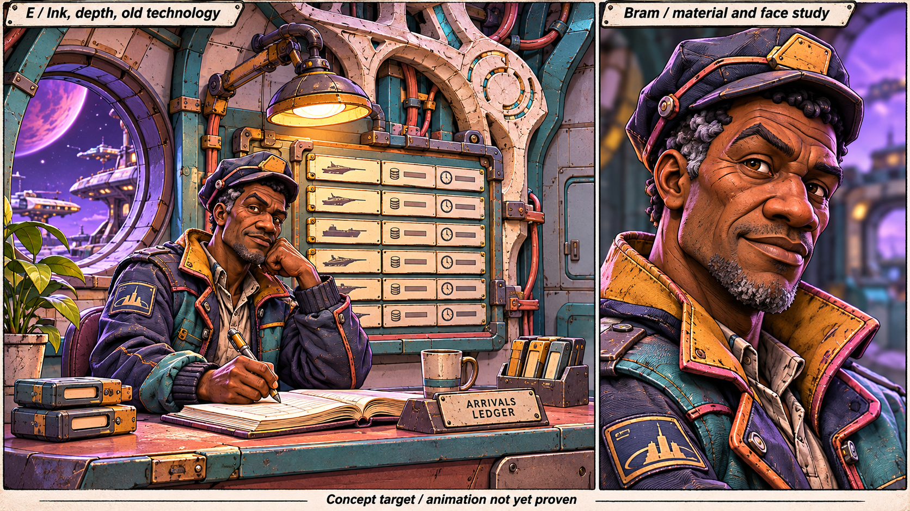
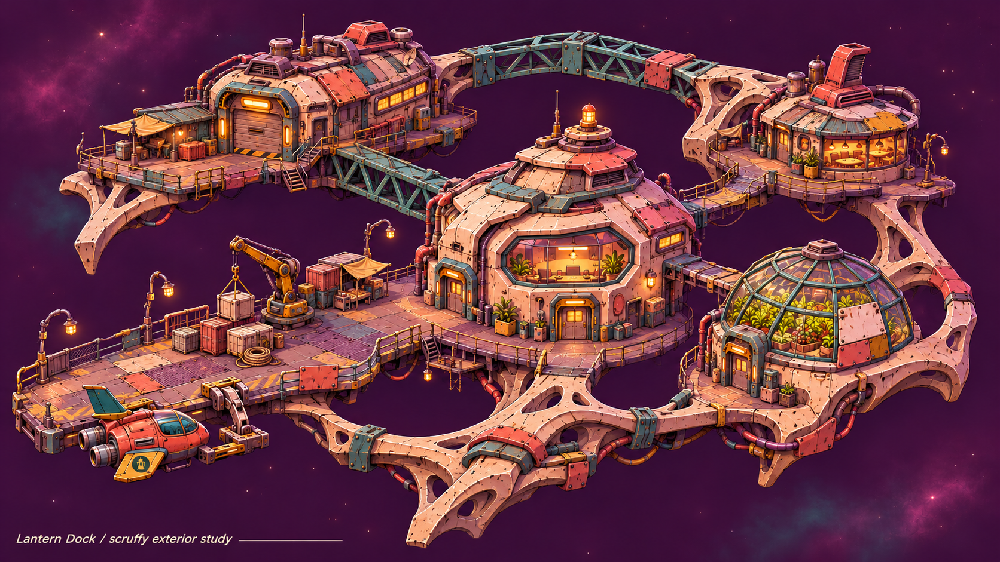
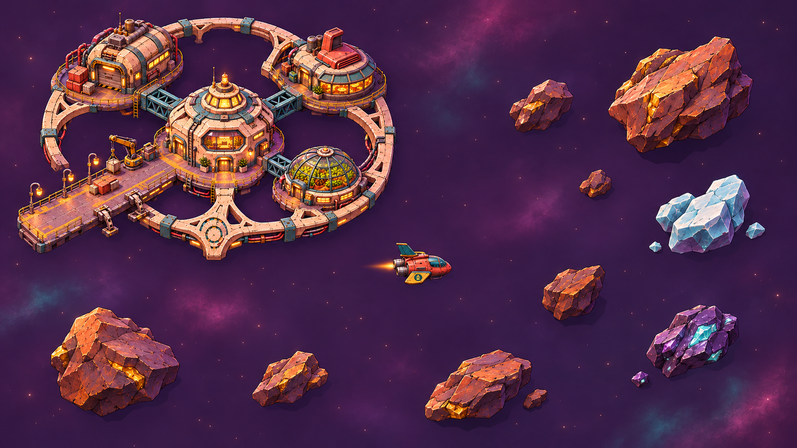

# References for the visual upgrade

Use this guide with the [incremental plan](../visual-upgrade-plan.md). Keep the
set small. A reference should answer a particular question, not become a folder
of attractive but incompatible images. The agent prepares comparisons; Andreas
does not need to learn a 3D tool to judge the result.

Research comparisons stay anonymous in repository files. Keep names of other
games out of plans, references, prompts and source URLs written here. Preserve
named source citations outside the repository; bring back only the applicable
criteria and test methods. References to general art and animation education
can remain when they do not identify another game.

## Starting visual references

These three images were generated during the sketch session. They are selected
starting points, pending the direction amendment. None is an engine capture,
exported asset or animation proof. Do not score a runtime build against every
incidental object or invented mark in an image.

### Room materials and faces

Use the saturated painted surfaces, fine drawn wear and cloth accents, plum
contours, dimensional faces and warm/cool lighting contrast. Preserve adult
identity through expression. Treat scratches as marks attached to the model's
material, not lines that stay fixed on the screen.

Reduce clutter and indiscriminate damage. The particular patches, facial hair,
symbols and unfamiliar structural motif remain proposals. Bram's final identity
needs approval in actual geometry. The side-by-side face view is an art study,
not a replacement for bubbles above people in rooms.

### Scruffy station construction

Use the irregular supports, mismatched repairs, patched roofs, working pier,
warm windows and distinct destinations. Look for practical human additions
around unfamiliar construction. Keep docking and walking routes understandable.
This depicts an established station; the core's unbuilt and progressing states
need their own appearances. Beings and working machines are still to be designed.

The alien influence is a visual direction, not permission to add story evidence
about the ring or the player's origin.

### Preferred flight camera

This is the earlier, lower-angle flight image Andreas preferred. It is the
reference for visible depth, the relationship between station, ship and rocks,
and their separation from the coloured background. The later near-top-down
revision is not the selected camera.

This image still contains the older, neater station. For construction, use the
scruffier station above. Remove the false dark patches under rocks; space has no
floor receiving those shadows. Rock spacing, station scale and fine-detail
visibility remain things to test during play. The first geometry test uses a
45-degree tilt from vertical as an approximation, not an approved numeric camera.
Flight has no vertical steering regardless of the viewing angle.

## Motion references we need next

A still establishes colour and detail. A short clip establishes how an object
moves. Before building an action, the agent supplies a simple labelled example
or makes a rough motion study. Use ordinary observed movement as well as stylised
animation, and compare at normal speed first.

| Action | Reference to collect or make | What Andreas should judge |
| --- | --- | --- |
| Glance and short line | A 5-to-10-second head/shoulder study using the proposed character | Eyes notice something, head follows, body settles. The person stays recognisable. Mouth movement must suit text-only dialogue; exact spoken lip synchronisation is not a requirement. |
| Read, reach and point | A hand moving from a ledger to a board, filmed or animated in side and room views | Hand approaches, meets the intended place, pauses and returns. It does not pass through the board or float over the book. |
| A few steps and a turn | One adult walking, stopping and turning in the actual room | Feet stay put while bearing weight; hips and shoulders move naturally; stops have a small settle. The same loop does not give every keeper the same personality. |
| Cargo crane | A short lift, carry and release at the actual pier | The load hangs from the hook, accelerates and stops with weight, and lands on its support. It remains out of the player's approach and labels. |
| Ship manoeuvre | The actual tug turning, braking, passing behind structures and berthing | The view explains where the tug is. Effects agree with its motion. A hidden-tug treatment preserves depth without making everything transparent. |

Use original recordings or permissioned material if storing external clips.
For third-party references, link the source and describe the useful moment rather
than copying its media into the repo. The owner-supplied commercial-game image is
kept out of the public reference files. Accepted runtime clips eventually become
the most useful references for keeping later work consistent.

## Optional introductions

[Pixar in a Box](https://www.pixar.com/pixar-in-a-box) is Pixar's collaboration
with Khan Academy. Its [animation introduction](https://www.khanacademy.org/pixar/animate)
uses a bouncing ball to explain how a sequence of positions becomes movement.
Use it for noticing timing and spacing, not for adopting its characters or style.

[Blender Studio's animation fundamentals](https://studio.blender.org/training/animation-fundamentals/)
progresses from basic motion towards acting. It is an optional reference for the
agent when preparing motion studies; Andreas does not need to take the course.
The course overview describes that progression. Lesson access was not verified.

The agent translates these ideas into plain observations during each test:

- **Timing:** how long something takes. A heavy crane load starts more slowly.
- **Spacing:** how far it moves between frames. Uneven spacing can make a move
  accelerate smoothly or jerk unexpectedly.
- **Anticipation:** a small preparation that makes the action understandable,
  such as shifting weight before standing.
- **Follow-through:** parts settle after the main motion stops, such as a coat
  hem after a turn. Keep this restrained for the calm tone.
- **Staging:** arranging camera, pose, light and props so the important action
  is easy to see.
- **Contact:** hands and feet meet the objects supporting them. This often
  matters more than adding another idle animation.

These are observation tools, not a required animation style. Subtle motion can
score highly; constant movement is not the definition of liveness.

## Rendering and asset references

The [asset and rendering check](asset-and-rendering-check.md) links official engine
documentation and describes the small asset and runtime proofs before room assembly. Use
it to identify whether a visible gap comes from the authored model/material,
import settings or runtime support. It does not select an engine or add new
score categories. An asset must survive real runtime movement and interaction;
a generated image or authoring-tool render is not enough.

## Office camera comparison

After the individual visual proofs pass, Bram's office compares staged and shoulder
views. The same room assets, lighting, interaction state and moving being appear
in both. The shoulder view is a candidate for owner testing, not an accepted
replacement for staged rooms or a commitment to corridors. The player figure can
be temporary; its presence tests body obstruction and movement, not final identity.
Use the [office test](../visual-upgrade-plan.md#office-assembly-test)
for the comparison rather than different concept images or separate art passes.

## Character references

Before modelling or animating the anchors, read their
[being sheets](../../modules/core/beings/README.md). Hessa, Mags, Sefa and the player
have authoritative sheets. The sketch of Bram does not establish the appearance
or personality of every other being.

For each being, keep one approved front/side/three-quarter model study, three
expressions and a short motion study. Approve the clothed model at actual talk
size as well as enlarged. Record what must stay distinctive and which details
are still open. For keepers without sheets, agree the visual and gesture brief
from existing content rather than inventing a backstory.
