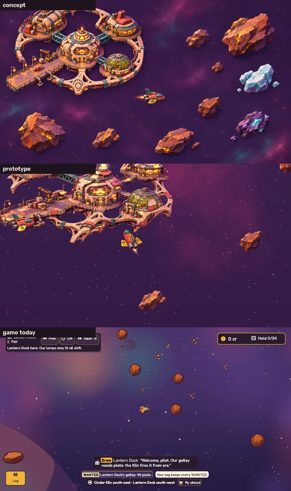
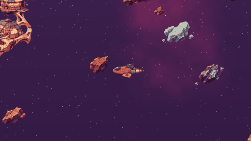
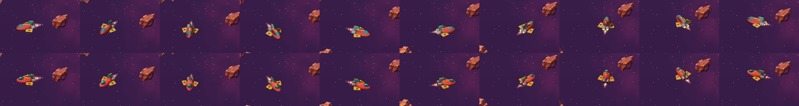
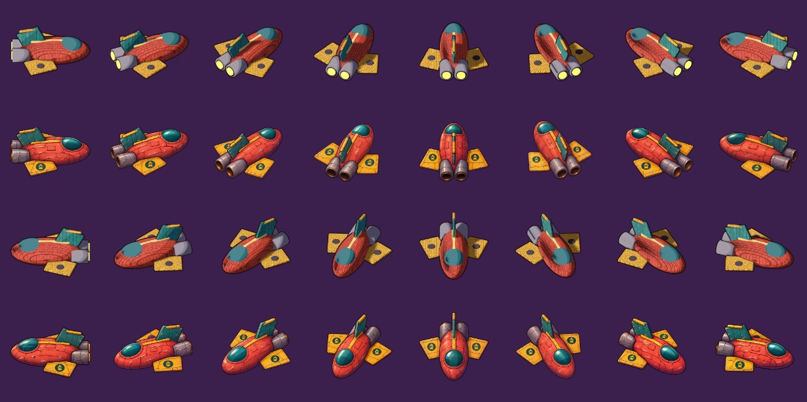
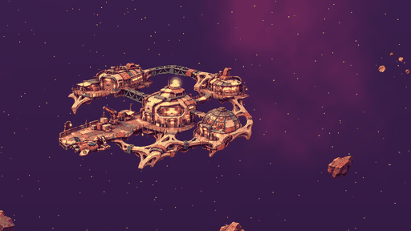
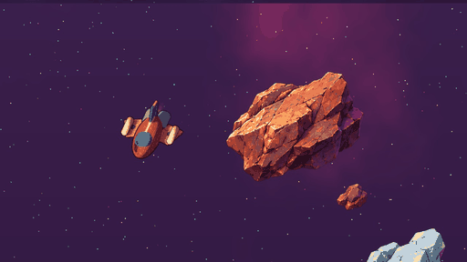
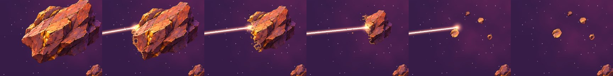
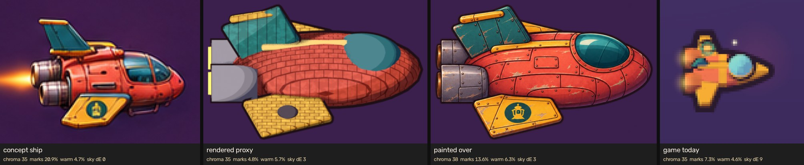

# Outer look: the concept's look without true 3D

**Question.** How can flight and the station seen from outside get much closer to the
concept art (`game/docs/direction/hint-station-and-flight.jpg` and its two source
paintings) without true 3D rendering?

**Answer.** Paint what doesn't turn; give what turns a painted turn sheet. The station and
rocks become painted plates and sprites, with light, glow and mining drawn on top at
runtime. The ship becomes 16 painted views, made by painting over renders of a simple
model. Stations stay one painting each unless their parts are painted as a kit with fixed
joins (see "What breaks").

Everything here is offscreen: a Python compositor draws what the engine would draw. No
game window was opened, and nothing in `engine/` or `game/` changed.



## The routes

| Route | Art per asset | Engine work | Turning | Zoom | Mining stages | Motion and light |
|---|---|---|---|---|---|---|
| **A. Painted plates and sprites, turn sheets for what turns** (built here) | station: 1 painting at 2× flight size; rock: 1 per shape; ship: 16 views | textured sprites with alpha, additive glow quads, frame picked by heading, a mask that eats a sprite, hit shapes on a plate | 16 views plus in-plane turn of up to ±11° between them | holds to the painting's own size (2× here) | mask erosion of one painting, or 3–4 painted stages | overlays: lamps, beam, flame, sparks, hover; light is baked |
| B. Top-down sprites, rotated freely | 1 painting each | least: rotate any sprite | free | as A | as A | the painted light turns with the sprite unless normal-mapped |
| C. Normal-mapped lit sprites | painting plus a normal map (hand-made or derived) | a lit sprite shader | as A or B | as A | the normal map must be eroded too | lights really move over the paint |
| D. Hybrid: painted station and sky, today's 3D renderer for ships and rocks | station painting; ships and rocks as today | sprite plates under the 3D pass | free | free | as today | live |
| E. Pre-rendered sprites from a 3D model | a model per asset | as A | as A | as A | a render per stage | baked |
| F. Layered 2D with parallax | painting split into depth layers | layer stack per sprite | none | parallax only | per layer | small parallax shifts |

Why A: the concept is seen from about 40° above, so the station's walls, windows and
domes are visible. B loses that, because a top-down sprite shows roofs. D and E keep the
modelled look for ships and rocks, and the 3D lessons (outside the repo, summarised in
`NEXT.md` there) say code-made looks read as generated however they measure. That shows
again here: the rendered ship scores worst of the painted pieces below. C is an upgrade A
can take later for moving light. F adds nothing a fixed-angle plate needs.

## What was built

- `scripts/cut.py` cuts the two concept paintings into a station plate, rock sprites and a
  ship crop. These stand in for the paintings an image tool or painter would deliver.
- `scripts/ship_frames.py` renders a simple model of the concept's ship (Blender, run in
  the background) at 64 headings, plus a set with a fitted part (wing pods).
- 16 of those renders were painted over by an image tool (Codex's built-in `image_gen`,
  the tool that made the concepts), given each render plus both concept views of the
  ship, with the first painting as a reference for the rest.
- `scripts/scene.py` composites three clips: the ship loops in front of the station and
  flies past; the ship mines an iron rock to pebbles; the camera zooms in to dock while
  rooms light up on hover.
- `scripts/station_parts.py` rebuilds a different station from parts cut out of the plate.
- `scripts/judge.py` scores pictures against the concept and makes the sheets below.

## What it looks like

**Flight.** The ship loops at the 180°/s turn rate and flies past the station. It uses
the 16 painted views; headings between two views turn the nearest view in the screen
plane, which reads smoothly in motion.





**The turn sheet.** Rows 1 and 3 are renders, rows 2 and 4 the paint-over. Silhouettes
overlap their renders at 0.98–0.99, except two views at 0.82 and 0.86. The paint-over
keeps the model's plain shapes, so the ship's design has to be modelled close to the
concept first.



**Docking.** The plate is painted at twice its flight size, so docking zooms about 2.7×
and still shows full paint. Windows breathe in six phase groups (one band flickers like a
failing tube), the beacon blinks, and the hovered room is outlined.



**Mining.** One painting is eaten from the side facing the ship. The rock shrinks, gets a
warm bitten face, ink at the cut and growing cracks, and leaves warm-capped pebbles. The
beam ends on the sprite's current edge.




## Scores

`judge.py` measures every picture at the same height. *Marks* is the share of painted
(non-sky) pixels on a fine drawn edge; *sky dE* is the colour difference of the darkest
quarter from the concept's (CIE76; under about 10 reads as the same paint).

| | Concept | Prototype | Game today |
|---|---|---|---|
| Whole frame: chroma / marks / warm light / sky dE | 32 / 14% / 3.2% / 0 | 32 / 18% / 2.0% / 1.5 | 30 / 5% / 0.9% / 5.9 |
| Ship marks | 21% | rendered 5%, **painted over 14%** | 7% |
| Iron rock marks (zoom 1.55, whole / half mined) | 11% | 4.5% / 4.5% | 0% |
| Station marks, docked | 17% | 10% | n/a |



Numbers stop drift; they don't prove a look. Sheets: `evidence/score-*.jpg`.

## What breaks, and what it costs

- **Paint resolution.** Plates lose fine marks once they are drawn larger than they were
  painted (the rock at zoom 1.55: 11% down to 4.5%). Paint at 1.5–2× the largest
  on-screen size. For a station that docking zooms into, that is roughly a 3000 px
  painting.
- **A station cut into parts doesn't recombine.** Bridges end in mid-air and ring arms are
  left as stubs (`evidence/station-from-parts.jpg`). Stations as recipes of parts
  (direction 1.3) need a painted kit: each part painted separately, with deck edges and
  connectors at fixed points, plus connector pieces. Otherwise each station is one
  painting, and its variants (growth stages, damage, a new room) are painted overlays.
- **The ship's design has to be modelled first.** The paint-over follows the model
  closely. A plain model gives a plain painted ship. A model built to the concept (canopy
  frame, panel layout, nozzles) is the main lever left.
- **Consistency across views.** Small details drift between the 16 paintings, and 2 of 16
  drifted in outline. A painted turn sheet needs one review pass and a retry or two.
- **Fitted parts** need their own turn sheets, painted over renders of the ship with the
  part, so they line up with the hull. The pod renders exist here; their paint-over was
  not done.
- **Light is baked.** Lamps, beam and flame add glow on top, but nothing casts moving
  light or shadow over the paint. Route C (normal maps) is the upgrade if that's wanted.
- **Camera angle is fixed.** Plates are painted from one angle (about 40°). The camera
  can follow and zoom, but not tilt or orbit.
- **Rocks.** Here they wobble only a little and never turn. A rock that spins needs a turn
  sheet like the ship.
- **Performance** is a sprite batch: about 20 textured quads plus a few glow quads a
  frame. A full-detail station plate is a 3000×1700 texture (about 20 MB).

**Engine work, all generic:** textured sprites with alpha from a module's images, a
frame-by-heading picker for turn sheets, glow quads in phase groups (breathe, flicker,
blink), a mask that eats a sprite with a coloured edge, and hit shapes on a plate for
clickable parts. No game nouns are needed; looks stay in the module.

**Art per asset:** a station is one painting plus its masks (lamp masks are found
automatically from warm bright pixels); a rock is one painting per shape (plus 3–4 stage
paintings if the mask erosion isn't good enough); a ship is a model built to its
concept, 16 renders and 16 paint-overs, and the same for each fitted part.

## Recommendation

Adopt route A for the outer world:

1. Stations as painted plates with glow and hit-shape overlays, painted at 2× flight size.
2. Rocks as painted sprites, mined by mask with a bitten edge.
3. Ships and fitted parts as 16-view painted turn sheets, painted over renders of a model
   built to the concept.

Then decide one open question: are stations one painting each, or a painted kit of parts
with fixed joins? A kit keeps the recipes and themes from 1.3 but costs a painting pass
per faction kit.

## Proposed text for `game/docs/direction.md` 1.6

To be written there once Andreas agrees:

> **The outer world's look (the outer-look lab, 2026-11-10).** Flight and the station
> from outside are painted, not modelled. Stations are painted plates seen from a fixed
> camera about 40° above the plane, painted at twice their flight size so docking can
> zoom in. Lamps, windows, the beacon and hovered rooms are glow overlays on the plate,
> and rooms are hit shapes on it. Rocks are painted sprites, mined by eating the sprite
> from the side facing the ship, with a warm bitten edge, inked cracks and pebbles at
> empty. Ships and fitted parts are 16-view painted turn sheets, painted over renders of
> a model built to the concept; in-between headings turn the nearest view. Light is
> baked into the paint; beams, flames and lamps add glow on top. Open: whether stations
> are one painting each or a painted kit of parts with fixed joins. Reference:
> `prototypes/outer-look/`.

## Running it

The concept paintings are not in the repo. With them in `<concepts>`, Blender 4.2 or
newer, and Python with `opencv-python`, `numpy`, `pillow` and optionally `imageio-ffmpeg`:

```sh
python -I scripts/cut.py <concepts> <work>/cut
blender -b --factory-startup --python scripts/ship_frames.py -- <work>/ship 64 256
python -I scripts/scene.py <work> <work>/out                           # all three clips
python -I scripts/scene.py <work> <work>/out_painted --only flight --ship painted   # needs <work>/paint/out
python -I scripts/station_parts.py <work> evidence/station-from-parts.jpg
python -I scripts/judge.py sheet.jpg concept=<concepts>/flight-preferred.png prototype=<work>/out/flight/00150.jpg
```

For the paint-over: render 16 headings (`ship_frames.py -- <work>/ship16 16 512`), and
give an image tool each render plus the concept's ship as references. Ask it to keep the
render's exact silhouette, heading, scale and placement, with a transparent background;
paint heading 0 first and pass it as a reference for the rest. Save the results as
`<work>/paint/out/paint_NN.png`.
