# Concept-first room: projecting the concept painting onto a 3D room

A six-hour prototype (2026-11-09) on Bram's arrivals desk. It asks one question: can we take the
concept painting itself as the texture of a 3D room, make the room move and take real light, and
write down a procedure we can repeat for other rooms and beings?

**Answer:** yes, within a range of camera angles. From the painter's camera, frame 1 reads as the
painting relit. A slow push-in toward Bram holds. Moving sideways past about 0.5 m, or turning the
camera 25°, leaves the painting, and Bram becomes a stretched cut-out. The procedure is repeatable:
every step is a script, and `scripts/room.py` reruns the whole chain.

It ran in parallel with a modelled track (a cel-shading kit, on the room-look branch), and the two
swapped findings during the day. The modelled room holds from every angle but is less painterly.

## Verdict: not the method for walkable rooms

Rooms in the rework are walked through over the player's shoulder (`game/docs/direction.md` 1.6).
A follow-up measured how much of each view the painting covers. About half of every view past 25° of
yaw or a 0.8 m step was never painted: it lies off the painting's edge or behind Bram and the lamp.
A trusted matte and stand-ins carved to it fixed the tearing along Bram's outline but moved those
shares by only 1-4 points, because no cut-out can add paint that doesn't exist. Generated paint can
fill in what Bram hid, but an image generator re-invents the room when asked to extend it (the desk
became a stage), so it can't supply consistent paint for a moving camera.

So rooms are modelled. Projection stays useful for what lies beyond a room (skies, views through
windows: the porthole layers here), for fixed shots, and as a starting texture on a modelled object.

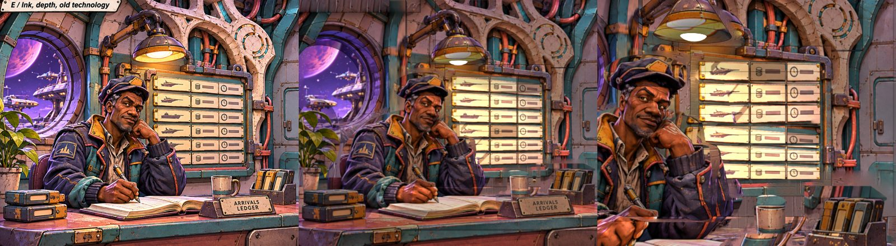

*Left: the concept. Middle: frame 1 of the render. Right: the end of a 0.55 m push-in toward Bram.*

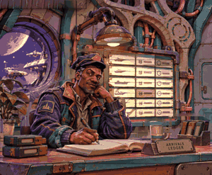

## What's in this folder

| Path | What it is |
|---|---|
| `WORKFLOW.md` | The recipe, step by step, with the numbers Bram's desk used. Start here to reuse it. |
| `LOG.md` | Each piece as it was built: what was done, what worked, what failed, evidence, a self-assessment. |
| `scripts/` | Blender 5.3 background scripts and plain-Python image maths. |
| `evidence/` | A curated, size-limited set of renders (the full renders stayed in the working folder). |

The concept painting is not committed: put the cropped concept at `concept/room.png` (1083×893)
before running. Script outputs go to `pieces/` and `export/`, which `.gitignore` excludes.

## The procedure in one picture

```
concept.png
  │
  ├─ 1 match the painter's camera (scale fixed by the character's head)
  ├─ 2 block the room out from pixel rectangles (boxes, blobs, rods; one depth guess each)
  ├─ 3 ID render: per-object masks in concept pixels, median colour per object
  ├─ 4 delight per object + measure the painter's light (shadow colour, lamp colour, ink)
  ├─ 5 bake the projection to UV textures; fill what the painting never showed
  │      └─ matte the character and props (stand-ins are larger than the paint; a matte trims them)
  ├─ 6 relight in EEVEE with real lights, using a light model whose two ends are measured
  └─ 7 bring parts to life with the painting's own paint (board cards, porthole layers, breathing)
```

## How each step worked

### 1–3. Camera, blockout, ID render

The camera is matched without tilt, framing by lens shift, because the concept's verticals are
parallel. **Scale comes from Bram's head (about 0.23 m face), not the props**: painters exaggerate
heroes and hero props. That put the eye at 1.58 m, the wall 2.29 m away and the counter at 1.05 m.
Each object is a pixel rectangle plus one depth guess, turned into metres through the camera. The
blockout's edges land within a few pixels of the painting.

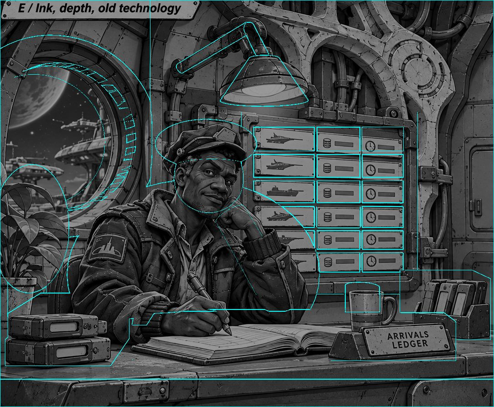

Projected onto the blockout and seen from other angles, the paint already shows where it will break:
surfaces the painting never saw, and smears at grazing angles.

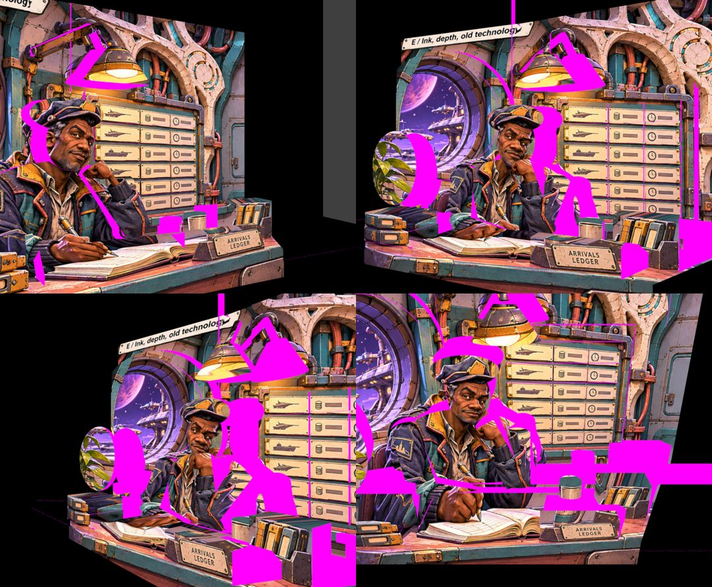

### 4. Take the painter's light out, and measure it

Inside each object's mask, a blur of brightness that stays within the mask is divided out, then
rescaled to the object's median. Painted gradients go; ink, rivets, labels and wear stay. The same
blur gives the painter's light:

- **Shadow colour**: the blurred colour where painted light is weakest, divided by where it is
  strongest, averaged over big surfaces. Here (0.24, 0.25, 0.38), a violet multiplier.
- **Lamp colour**: one material near the lamp divided by the same material far from it,
  giving (1.00, 0.86, 0.76). Dividing the concept by the delit image gives grey instead, because
  delighting keeps hue.
- **Ink**: the median of the 1–5% darkest pixels, a near-black brown.

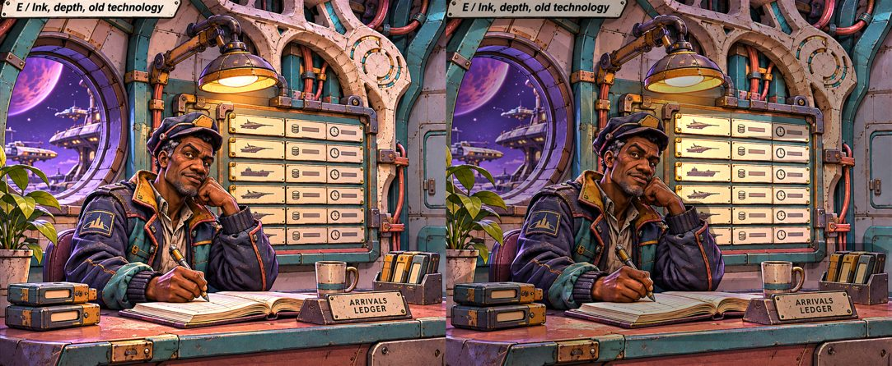

### 5. Bake, then fill what the painting never showed

Cycles bakes the projected paint into each object's UV texture. A second bake, with one light at the
projector, measures how squarely the painting saw each texel; texels it didn't see are filled. Colour
comes from a smooth continuation, and fine grain is copied from the same object's seen paint.
Copying whole patches was tried and rejected: it invented pipe clamps.

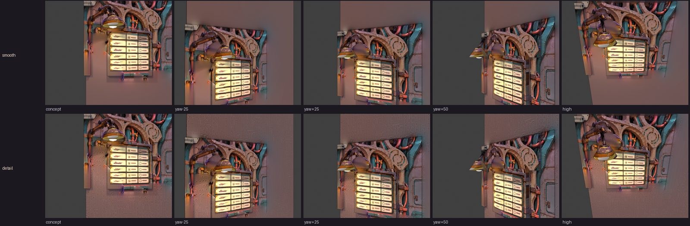

**Characters and props were the hard part.** A blob never matches a painted silhouette. The first
whole-room render showed a halo round Bram's head, Freestyle ovals round his body, boxes round the
mug, and his jacket paint baked onto the wall:

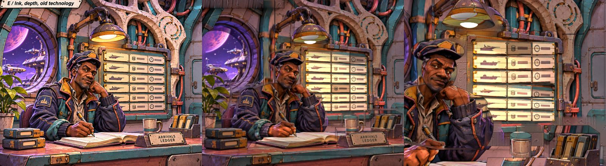

The fixes, in the order they were found:

1. **Guard band.** Background texels within 12 px of a foreground silhouette count as unseen.
2. **Difference matte.** Render the background alone and compare it with the painting. Where they
   match, the stand-in is see-through (an alpha texture).

   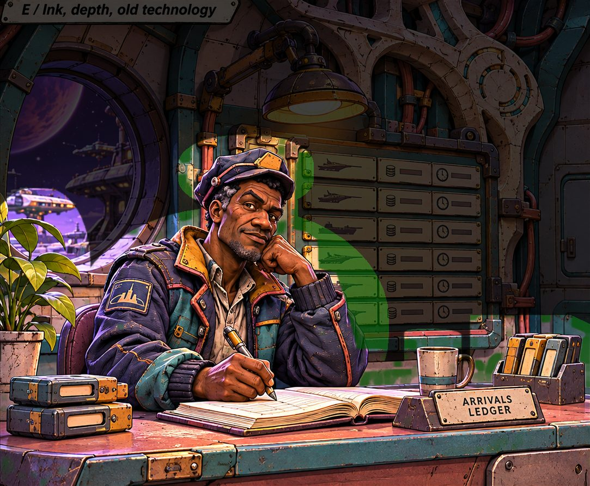

3. **Stand-ins larger than the paint.** Bram's epaulette lay outside his torso blob and was lost.
   Stand-ins are now about 10% larger, and the matte trims the excess.
4. **Delight with painted masks, not blockout masks.** Otherwise the stand-in's outline leaves a seam
   in the wall's paint.
5. **Ink only where the geometry matches the paint.** No ink on stand-ins, so no ovals or boxes.
6. **Test each cut-out alone over a flat background.** That showed a fully opaque torso with board
   paint inside it, which whole-room renders had hidden for an hour:

   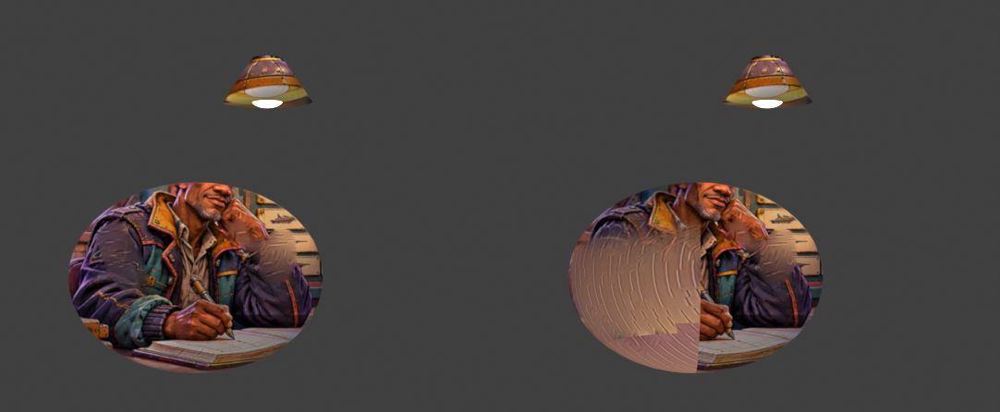

7. **A hand-traced exclusion polygon.** The automatic matte confirms its own mistakes. Where it keeps
   background as Bram, the next bake hides that background, fills it, and the matte sees a mismatch
   there again ([diagnosis](evidence/05-slot-loop-diagnosis.jpg)). One 11-point polygon, traced in
   minutes, broke the loop.

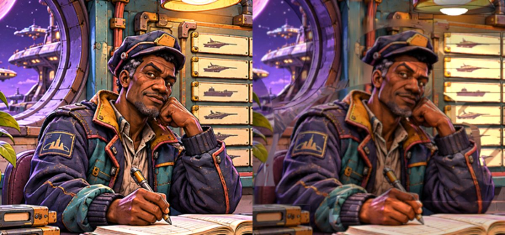

*Concept (left) and render (right) after the fixes. The [before](evidence/05-bram-zoom-before.jpg)
has the head halo and the ghost ellipse.*

### 6. Relight

The light model runs in EEVEE, reading the light that arrives (Shader to RGB of a white diffuse):

```
final = albedo × ( shadow_colour × (1 − min(t,1)) + light_tint × t ),   t = light / lit_level (cap 1.4)
```

Unlit is the painter's shadow colour, and lit is the delit concept, so both ends are measured.

- **Painted glow is light.** The lamp shade's glowing texels follow the real lamp's flicker.
- **The painter's key light casts no shadow.** Its hard shadow of the lamp read as a second lamp once
  the camera moved.
- **The response saturates fast, so tune lights in small steps.** Mounted in the modelled room, the
  board went from dim at 1.5 W to blown out at 3.5 W.

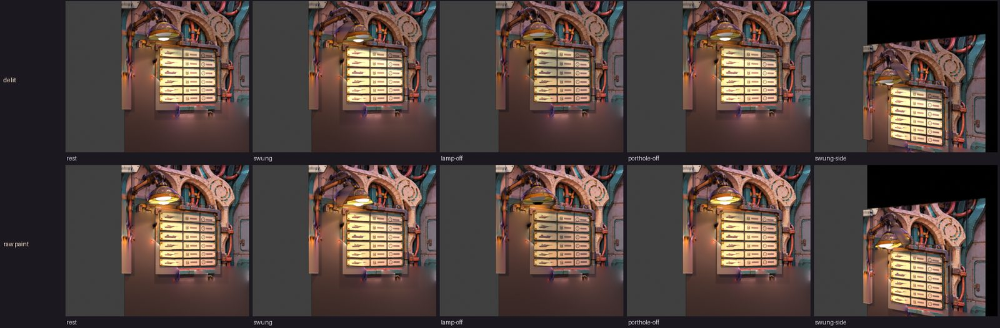

### 7. Life, from the painting's own paint

- **The arrivals board is a split-flap display.** Each slot flips through the next rows' painted
  cards (a static top half, a static bottom half, and a hinged flap whose back is the next card).

  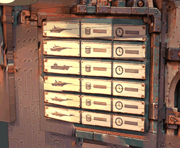

- **The porthole is a stack of layers cut from the painting**, on planes parallel to the image plane
  at 12, 25 and 90 m. Because the planes are parallel, their UVs stay exact, and distance gives the
  parallax. The sky is a padded plate that fades to the painter's deepest sky colour, with stars at
  the density measured in the painted sky. The tower's windows blink.

  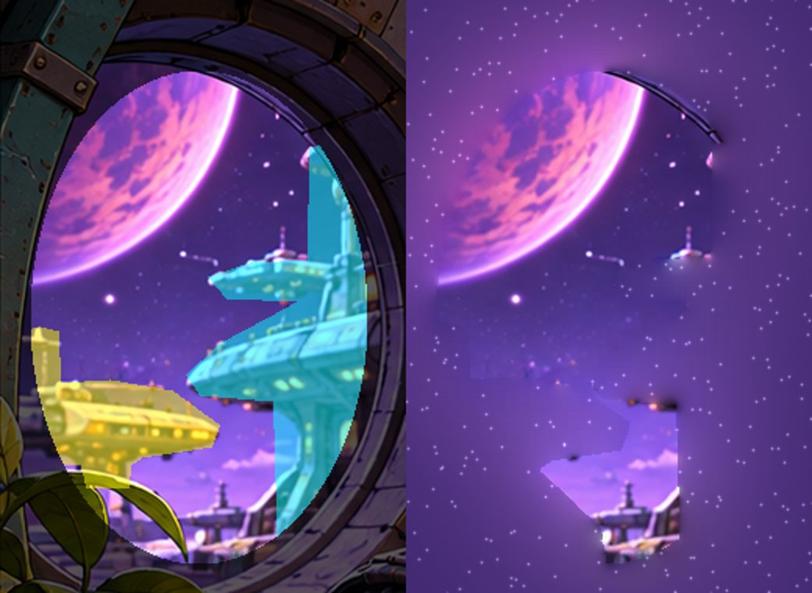 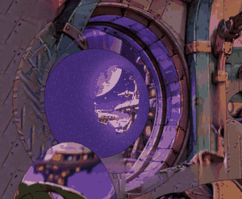

- The lamp sways and flickers, and Bram breathes (a small scale and tilt about the hips).

## Where it holds and where it breaks

| Camera | Result |
|---|---|
| Concept camera | Reads as the painting relit. Brightness is about 0.77 of the concept, saturation 0.16 vs 0.20. |
| Push-in 0.55 m toward Bram | Holds: the painted face survives ([strip](evidence/05-strip-push-in.jpg)). |
| 25° yaw or pitch | 4–14% of visible pixels were never seen by the painting. |
| 50° yaw | 21% unseen. |
| Dolly 0.8 m sideways | Leaves the painting: plain filled wall and desk beyond the frame ([strip](evidence/05-strip-dolly-0.8m.jpg)). |
| Side camera 25° | Bram reads as a stretched cut-out, and the porthole shows only deep sky ([strip](evidence/05-strip-side-25deg.jpg)). |

Still open:

- A faint arc of the torso stand-in shows over the porthole beside Bram's shoulder.
- Bram can't turn his head or blink without a second painted view or a modelled face.
- A full rebake takes about 25 minutes; the plain-numpy detail fill is the slow part.

## Running it

```
# Blender 5.3 on PATH, or set BLENDER_EXE; Python 3 with numpy and Pillow
python -I scripts/room.py        # everything, in order (about 30 min on the PC it was built on)
python -I scripts/piece5.py render,sheets   # only the whole-room animation, from an existing bake
```

Blender always runs in the background (`-b --factory-startup --disable-autoexec`).

## Next

A research pass is looking at how to widen the camera range and remove the tearing at stand-in
edges: multiple projection views, depth-refined geometry, modelled characters with projected
paint, and matte segmentation. Its results go into the room-look work, not into this
prototype.
