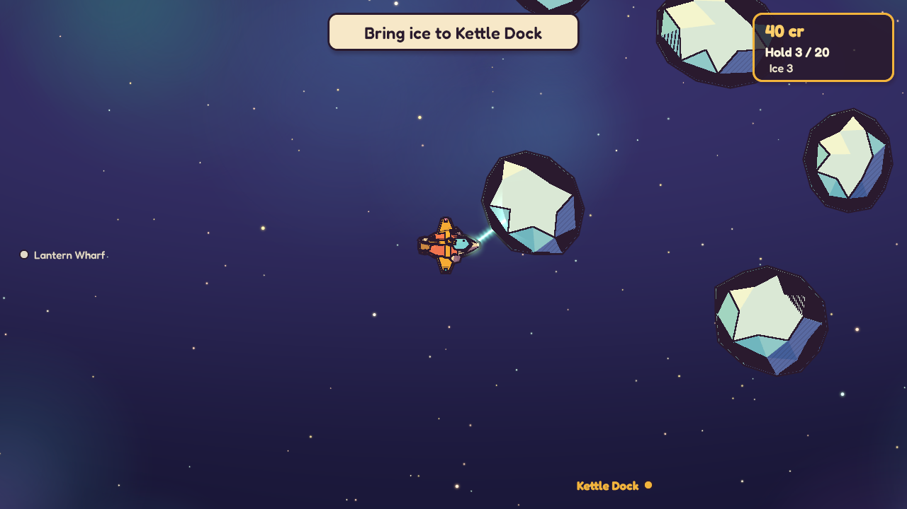
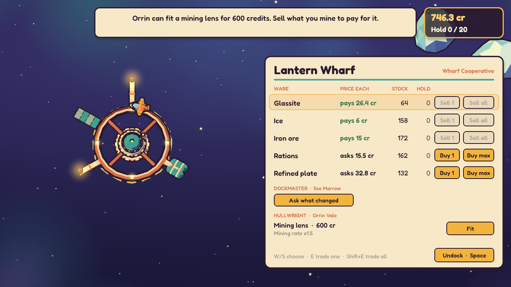
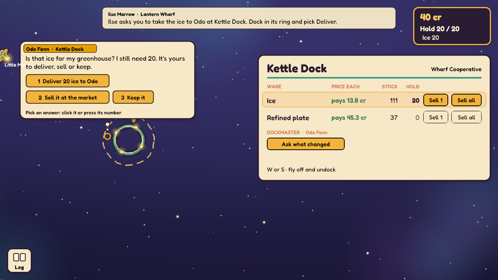
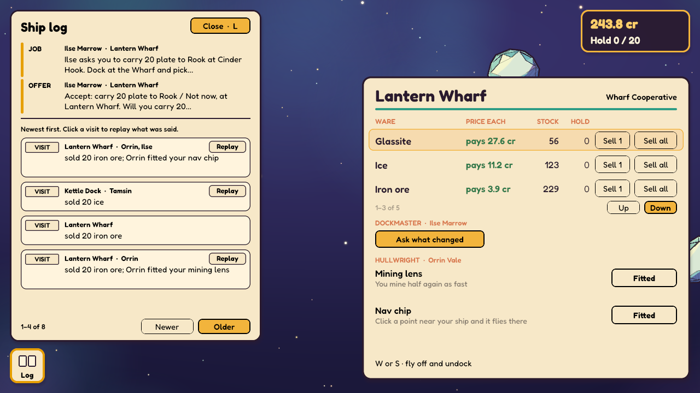
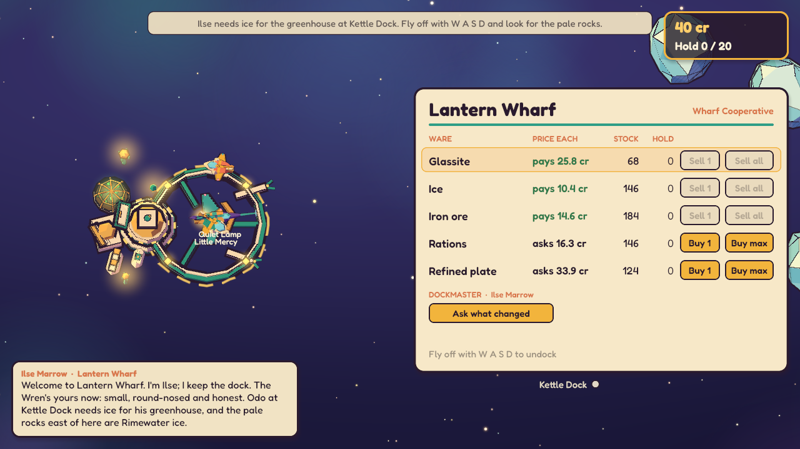
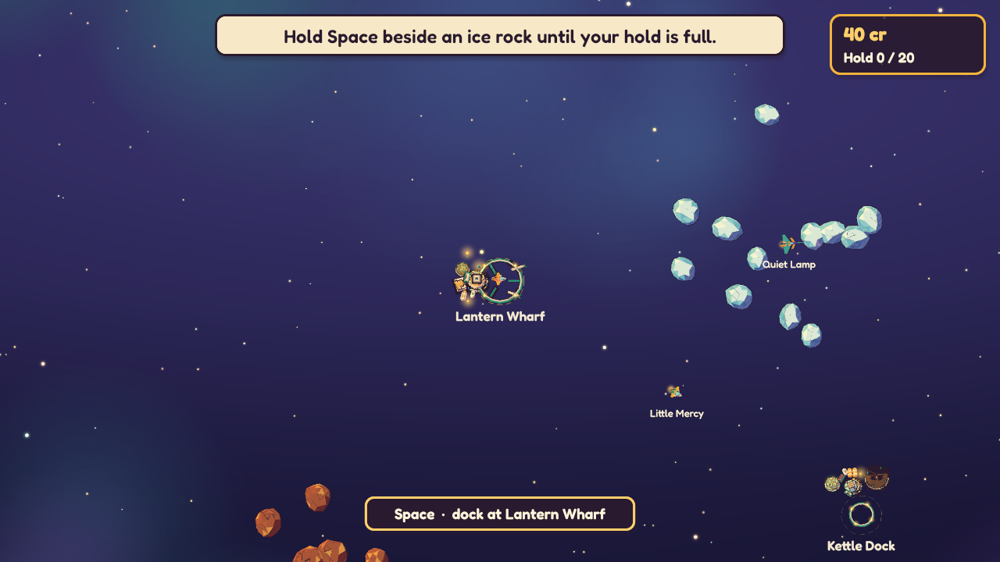

# The Lantern Reach (slice 01)

The first vertical slice of Irudd Galaxy: a calm, solo, top-down space mining and
trading game in Rust. Brief: issue #10, with the decisions in the kickoff comment on
PR #11. Design: `design/vertical-slice-lantern-reach.html` at the repository root.

## Status: complete, merged into main

The whole slice is in: all 17 beats across four acts, playable in a window from a new
game to the Hearthbound choice and home again, with the three factions, the named NPC
traders, the tender, the eight game-master change types as validated script packs, and
the live game-master socket. The journey bot finishes both runs headless (core plus
game-master packs, and core alone), and `cargo xtask check` passes on Windows and Linux.
[STATUS.md](STATUS.md) is the end-of-run report: what works, what doesn't, and what
needed a base change.

What to expect: Act 1 takes minutes, and the journey bot reaches prestige in about two
hours of game time, as the design intends (a human's time is unmeasured). Use `--beat N`
(see "Testing the slice end to end") to skip ahead. The first playtest's notes on PR #11
are fixed: undocking by flying off, a faster start, the nav-chip hint, the mining lens and
the rock shading. The flight model, a station UI redesign, music and the map are on hold
for design. Sound is a few soft cues; there's no music. Art is drawn in code.



## Play

```sh
./play.sh            # macOS and Linux (Linux packages: see "Playing on Linux")
play.cmd             # Windows
```

Both build in release (thin LTO) and run `galaxy play`, which continues your latest save
or starts a new game. Arguments pass through: `play.cmd --new` starts over (the old save
stays), `--seed N` picks the new game's seed, `--save PATH` plays a particular file.

| Key | Does |
|---|---|
| **W A S D** | Fly. The ship stops when you let go. |
| **Space** | The one thing in reach: dock in a ring, ride a lantern current, or hold it by a rock to mine. A hint at the bottom says which; while you mine it shows how fast the ore comes aboard. Each hint retires once you've done what it says a few times (a notice, once you've seen it a few times); see "Hints" below. |
| **P** or **Esc** | Pause. The whole galaxy stops under the PAUSED card. |
| **M** | The map: regions, lanes, who holds what, and the prices you've seen, dated by your dockings ("?" where you haven't been). |
| **N** | Mute or unmute the sound (remembered between games). |
| **Q** | Station life full or quiet (also a button on the PAUSED card; remembered between games). Quiet keeps what the numbers say (stock piles, lamps, your sale on the crane, a crowd for news) and stills the rest. |
| **R** | The radio: the next channel in range, and past the last one, off (R again turns it on). The radio at the bottom right has the same as buttons: Prev, Off, Next. |
| **F3** | Small developer overlay: active beats and steps, activity counters, recent facts, mind spend and script health. |
| **Mouse wheel**, **-** / **=** | Zoom. |
| **Click** | Fly, mine or dock by clicking, once you've earned those controls (Act 2). Shift queues. Until then clicks do nothing. |

Docking swoops the camera in close on the station and tilts it to a three-quarter view
(undocking tilts back; a click finishes the move). The station shows what is going on in
it: the economy's own craft come in to their berths and leave, stock piles by the market
grow and shrink with its stock, the crane carries what you just sold from your berth to
the stalls, a small crowd gathers at the office when news has landed since your last
visit, the lamplighter lights one more lamp per station pulse, and workers stand at a
part being built. Each faction builds and peoples its stations its own way
(`packs/core/data/themes.toml`). Each of the station's parts is a module with
a hanging sign: hover one and it lifts, outlined in orange, and its sign says who keeps
it and what it offers; click it and the camera glides there and its room opens beside
it, leaving the station in view. **Back**, **Esc** or a right-click returns to the whole
station, and a click during a camera move finishes it. The station key along the bottom,
beside the log icon, opens any part in one click. A market or a dockmaster that no part
houses, as at a station a game-master pack founds during play, still has its room in the
key, with no module. A part that changed lately carries a ribbon (**New**, **Changed**,
**Closed**) for a few dockings; hover its icon for one line of news. The plate top left
names the station and who holds it: the owning faction, or "Contested" or "Unclaimed" (as
the map shows its region) for a station nobody owns, such as Cinder Hook at the start.

The market room lists the station's wares, each drawn as goods with its price on a tag,
the stock and what's in your hold. It's mouse-first: **Sell 1** / **Buy 1** trade one,
**Sell all** sells all of it and **Buy max** buys as many as fit and you can afford; a
button you can't use is a dashed outline, and a long market pages with Up and Down. Each
price moves a little with every unit, so selling all at once earns less per unit than
spreading it out. To leave, just fly off with **W** or **S**: there's no undock button or
key, and keys still held from the approach don't count until you press them again. A
trade you ask for goes ahead of the flagship's own queued orders, which wait their turn.

The wharf (Orrin's cradle at the Wharf) lists what he can fit now, with the price, what
it does in plain words, and what stands in the way ("Mining lens costs 600 cr. You have
160 cr."); **Fit** buys it, and a line says what changed ("Orrin fitted your mining lens.
You mine half again as fast."). What you already have from a station stays on its list,
outlined as **Fitted** (or **Yours** for a tender), so a service never vanishes once
you've bought it out. Every amount of credits on screen uses one format: whole, or one
decimal. Tamsin's berths at Kettle Dock build the tender once you've earned it, and
Orrin's prestige offer opens a card that says what stays and what resets before you trade
up. In the dockmaster's office, **Ask what changed** gets up to three things that
happened since you were last there, each about a real event. Station parts are data
(`packs/core/data/station_parts.toml`), and a game-master pack can open, close or take
one away at a calm moment (`ctx.parts`).

The goal banner at the top lists every active goal, newest first, each under who gave
it and where they are ("Rook Adeyemi · Cinder Hook"). A goal nobody gave doesn't show.
On the map the banner sits beside the map's title, so both stay readable.



The packs: a new game installs `core` (the journey) and `gm-examples` (the game-master
examples). `--no-gm` (or `GALAXY_NO_GM=1`) starts a game with `core` only and runs any
save without them. The core pack offers fitting authored dock lines, with slots
filled from their cited facts. With `OPENROUTER_API_KEY`, TypeSafe Jev picks one;
without a key, budget or a timely valid answer, the pack's most specific line wins.
The script checks the docking and citation again before speaking. These script
menus never use free phrasing (even if `talk.free_phrasing` is enabled for other
providers); every displayed word is authored or a fact value. Without a key the log
says so once.
`--hot-reload` reloads packs as you edit them (development).

Finding the way is part of the game: there are no waypoint arrows. Stations in your
region that are off screen show as small markers at the edge. `--goal-marker` (off by
default) is an accessibility aid that also marks the current goal's station, in gold,
wherever it is.

The window opens at 1280x720, the size the panels are laid out for, and won't shrink
below 960x540. Below 1280x720 the panels scale down to fit rather than clipping, and a
market longer than the screen scrolls with the selection. The panels are laid out
against each other so none covers another: bubbles stay in the room left of the dock
screen, under the goal banner and above the log icon, and get wider before they'd run
out of it; the hint pill moves right of the log icon when they'd meet.

### Talk and the ship log

At a dock, people talk in short bubbles over the part of the station they work at: the
dockmaster speaks from the office, Orrin from his cradle, Tamsin from the berths
(`packs/core/data/talk_anchors.toml` maps each role, or a person, to a spot on the
station's art). Click a bubble, or press **Enter**, for the next line, oldest first;
the bubble's foot says how many more are waiting, and **Skip** sends the rest to the
log. When someone asks you something (Odo's Deliver / Sell / Keep, Ilse's plate, Rook's
question about the depot, Orrin's about your flying), the answers are buttons on their
bubble, numbered for the keys **1** to **9**, and the bubble waits for one. What you
gave and got comes back as a dark ticket marked **Confirmed** ("Delivered 20 ice to
Odo · +120 cr").

Flying off ends the bubbles: nothing stays on screen in flight. Anything you didn't
click through is said again the next time you dock there.

The **Log** icon sits bottom left; click it or press **L**. While it's open the goal
banner steps aside, because the log pins the same jobs at its top:

- **Pinned:** every active **Job** under who gave it and where, **Cargo** you carry
  for someone ("20 refined plate in your hold for Rook at Cinder Hook"), and each
  **Offer** you left unanswered at a dock, with its answers and where to give them.
- **One line per visit**, newest first, ordered by dockings: the dock and who spoke,
  then what happened ("Kettle Dock · Odo" over "Delivered 20 ice to Odo · +120 cr;
  sold 5 ice"). Click a visit (**Replay**) to step through that visit's bubbles again.
- **Said:** a person's line that reached you in flight, marked "in flight".
- **Notice:** a dark ticket about a place (a world change, a note on the map).





Every kind carries its word and its own shape, so none depends on colour. The panel's
size is fixed by the screen; older entries page with **Newer** and **Older**. When
anything was said in flight or noticed since you last opened the log, the icon carries
a blue tag with the count ("2 new").

The log is read from what the save already holds (the docking facts, the talk lines,
the trades). Which lines are still waiting at which dock, and the "new" count, are kept
in the save file's own `app_talk` table, like the hint counts.

### Hints

Hints say the key and what it does, and each is taught a few times, then retires: the
Space hints for docking, riding a lantern current and mining after you've done each a
few times, and the "Your hold is full" notice and the mining-speed readout after
you've seen them a few times (the readout counts each mining rate on its own, so a
fitted lens shows its new rate again). How many times is data:
`packs/core/data/hints.toml`. The counts belong to the save: they're kept in the save
file's own `app_hints` table, beside the world, and never reach the sim or a replay.

Saves are written at calm moments (when you dock, when you pause, when you quit) to a
per-user folder: `%APPDATA%\Irudd\Lantern Reach\data\saves` on Windows,
a `saves` folder for the game under `~/Library/Application Support` on macOS,
`$XDG_DATA_HOME/lanternreach/saves` (normally `~/.local/share/lanternreach/saves`) on
Linux. Set `GALAXY_SAVES` to use another folder.

Sound is on at a modest volume: a few soft cues for docking, undocking, ore coming
aboard, a full hold and a trade going through. There's no beam tone while you mine.
In flight, the radio picks up the stations and lane beacons near you: quiet music
that fades in and out with distance, a little static at the edge of a channel's range,
and short lines from the station as text under the radio. The first time a channel
comes into range, the ship log notes "New signal". **N** mutes. The volumes (`master`,
`ui`, `world`, `radio`, from 0.0 to 1.0), the mute and the radio's Off live in
`sound.toml` in the save folder, which is written the first
time you play. Without an audio device the game just runs silent. The rules the
sounds follow are in [crates/audio/README.md](crates/audio/README.md).

A first loop: fly off the dock with W A S D, fly right into the ice field, hold Space beside a rock
until your hold fills, fly down and right to Kettle Dock, drift into its ring, press
Space, and sell.



## Testing the slice end to end

1. **Install and play.** On Windows run `play.cmd` from this folder; on macOS or Linux,
   `./play.sh` (Linux packages: "Playing on Linux"). The first release build takes several
   minutes. `play.cmd --new` starts a fresh game; your old save stays.
2. **Controls.** W A S D fly (and fly off a dock to undock), Space does the one thing in
   reach (mine, dock, ride a lane), P or Esc pauses, M opens the map, N mutes, F3 shows the developer overlay, and
   the mouse wheel zooms. Clicks fly, mine and dock once the nav chip unlocks them in
   Act 2; Shift-click queues orders in Act 3. Docked, the station is mouse-first:
   click a module or the station key to open a room; 1 to 9 answer people. See "Play" for
   the details.
3. **Skip ahead.** `play.cmd --beat N` (or `./play.sh --beat N`) lets the journey bot
   earn every beat before N with real play, then opens that checkpoint in a new save.
   Useful starting points: 6 (the nav chip, Act 2), 9 (the Cinder Hook dispute), 11
   (orders and loops, Act 3), 13 (the tender), 16 (the Hearthbound choice), 17 (coming
   home). A late beat takes several minutes to earn (b17 about ten), since the bot plays
   the authored pacing. `galaxy beat jump N --out PATH` makes the same save without a
   window.
4. **Feedback.** Comment on PR #11 with what you did, what you expected and what
   happened. A screenshot helps: `galaxy shot --live --out shot.png` captures the running
   window, and `galaxy gm digest --live` lists what changed recently, citing fact IDs.
   The F3 overlay shows the active beat and step for a "where am I stuck" report.
5. **Saves.** They're written when you dock, pause or quit, to
   `%APPDATA%\Irudd\Lantern Reach\data\saves` on Windows,
   `~/.local/share/lanternreach/saves` on Linux, and the game's folder under
   `~/Library/Application Support` on macOS. Set `GALAXY_SAVES` to use another folder.
   Each save keeps its game-master state in a folder named after it, beside it
   (`lantern-1.gm/` for `lantern-1.sqlite`), and `gm-inbox/` sits in the saves folder.

## Named trader traffic



Little Mercy, Ninefold, Even Keel and Quiet Lamp fly from the starting world.
Their faction, hull, home, allowed stations and wares, load limits and route
preferences are in `packs/core/data/craft.toml`. They use the same order runner
and compare-and-set market trades as the player, carrying at most eight units
of a ware and trading at most two wares per docking. The economy ranks complete
plans; the trader mind picks among the best few when available, with the top
utility plan as the default. Decisions happen on docking, never on a timer.

Their faction-painted hulls appear in flight and on the map. Dockings count
for the Hook dispute and carry rumors from the previous station without changing
truth. After enough activity during an ignored shortage, Even Keel favours Kettle;
its actual arrival delivers the Compact relief. The preference lasts afterwards.
If Even Keel can't come (it isn't in the save, or Kettle sees
`relief_fallback_pulses` more pulses first), the Compact sends the ice anyway.
Little Mercy gains the ice road after player relief and the Observatory route
after a Cooperative victory. A save made before the traders gets them when it
opens (one `craft_backfill` system batch per craft, at home with orders to dock),
and any `pacing.toml` tunable it lacks at its authored value (`pacing_backfill`).
A route choice still out when an autosave was written is asked again on restore,
so no trader stays parked.

## Playing on Linux

Desktop Linux on x86_64 with a Vulkan driver, under X11 or Wayland. Install the build
tools, ALSA's headers and the libraries the window opens at run time (the X11, Wayland
and xkbcommon libraries are loaded when the game starts, so their `-dev` packages aren't
needed):

```sh
# Debian 12+, Ubuntu 22.04+
sudo apt-get install -y build-essential pkg-config libasound2-dev curl git \
  mesa-vulkan-drivers libvulkan1 libxkbcommon0 libxkbcommon-x11-0 \
  libx11-xcb1 libxcursor1 libxi6 libxrandr2 libwayland-client0 libwayland-cursor0
# Fedora 36+
sudo dnf install -y gcc gcc-c++ make pkgconf-pkg-config alsa-lib-devel curl git \
  mesa-vulkan-drivers vulkan-loader libxkbcommon libxkbcommon-x11 \
  libX11-xcb libXcursor libXi libXrandr libwayland-client libwayland-cursor
```

NVIDIA's proprietary driver brings its own Vulkan driver; `mesa-vulkan-drivers` covers
AMD and Intel (and `llvmpipe`, a slow software fallback). Then install Rust with
[rustup](https://rustup.rs) (the pinned toolchain installs itself on the first build) and,
from a terminal in your desktop session:

```sh
git clone https://github.com/alundgren/irudd-galaxy.git
cd irudd-galaxy/slices/01-lantern-reach
./play.sh              # the first release build takes several minutes
./play.sh --new        # start over (the old save stays)
```

Saves and `sound.toml` go to `~/.local/share/lanternreach/saves/` (or `$GALAXY_SAVES`).
`cargo xtask check` works as on Windows; its `luau-analyze` needs glibc 2.34 or later.
`play.sh` finds a fresh rustup install by itself, but for running `cargo` directly in
the same shell right after installing rustup, first run `source "$HOME/.cargo/env"`.

If it doesn't start:

- **`no window system: ... Failed to open connection to X server`** or **`Could not find
  wayland compositor`**: no display. Run it from a terminal inside the desktop session,
  or set `DISPLAY` (X11, e.g. `:0`) or `WAYLAND_DISPLAY` (e.g. `wayland-0`).
- **`Library libxkbcommon-x11.so could not be loaded`**: install `libxkbcommon-x11-0`
  (Fedora: `libxkbcommon-x11`).
- **No GPU adapter, or a blank or broken window**: check `vulkaninfo --summary`
  (package `vulkan-tools`) lists your GPU. `WGPU_BACKEND=gl ./play.sh` uses OpenGL
  instead of Vulkan; `WGPU_POWER_PREF=low` picks the integrated GPU on a laptop.
- **Wayland or X11**: the game uses Wayland when `WAYLAND_DISPLAY` is set, X11
  otherwise. `WAYLAND_DISPLAY= ./play.sh` forces X11 (XWayland) if the Wayland window
  misbehaves.
- **No sound**: the game runs silent without an audio device; lines starting `ALSA lib`
  (`Unknown PCM default`) mean it found none. Sound goes through ALSA, so on PipeWire
  install `pipewire-alsa`, on PulseAudio `libasound2-plugins` (Fedora:
  `alsa-plugins-pulseaudio`).

## Build and check

You need the pinned toolchain (`rust-toolchain.toml`, installed by rustup on first
use). On Windows, the MSVC Build Tools; on Linux, the packages in "Playing on Linux".
Run everything from this folder.

```sh
cargo xtask build           # game, sharing dependency features with the workspace checks
cargo xtask cargo test --workspace # headless tests (no window, GPU or network)
cargo xtask check           # fetch-luau + fmt + clippy -D warnings + tests: run before every PR
cargo xtask contract        # regenerate crates/contract/schemas/ and api/ after a contract change
cargo xtask fetch-luau      # pinned luau-analyze (strict typecheck) into tools/luau/
cargo xtask build-report    # timings of cold, warm, no-op and test builds, as JSON
cargo xtask loc             # code lines per crate (src, unit tests, tests); --base <ref> for the change
```

Builds don't go to `target/`: `cargo xtask` builds in one of a few shared slots under a
per-user cache folder (`cargo xtask target-dir` prints the one in use), so a new branch
or worktree starts with its dependencies compiled. Only one compiling command runs at a
time on the machine; another one prints that it is waiting and starts when the first
finishes. `GALAXY_TARGET_ROOT` moves the slots, `GALAXY_TARGET_ROOT=off` builds into
`target/` again, and `GALAXY_BUILD_PERMITS` allows more builds at once. Details:
"Builds" in the root `AGENTS.md`.

Use `cargo xtask build` and `cargo xtask run -- <command>` during development;
add `--release` before `--` when needed. These select the game and xtask together,
matching the dependency features of the workspace check. The launch scripts use
this route too and respect the configured build folder.

Integration scenarios share one executable per crate (the app's process-environment
test stays separate). For a focused run, use a module filter, for example:
`cargo xtask cargo test -p galaxy-script --test integration journey_core::`.
Keep new scenarios in modules listed in `tests/integration.rs`; automatic test-target
discovery is disabled in consolidated crates. Unit tests remain in their libraries.

There is no CI. Checks run locally.

## The `galaxy` CLI

Every command prints one JSON value on stdout.

```sh
cargo xtask run -- new --save saves/a.sqlite --seed 7
cargo xtask run -- sim run --save saves/a.sqlite --ticks 3000
cargo xtask run -- state get --save saves/a.sqlite --path stations/station.kettle_dock
cargo xtask run -- history query --save saves/a.sqlite --kind dock --limit 20
cargo xtask run -- memory search --save saves/a.sqlite "sold ice" --station station.kettle_dock
cargo xtask run -- api dump --name world
```

Or build once and call the `galaxy` executable under `debug/` in `cargo xtask target-dir`.

| Command | What it does |
|---|---|
| `new --save PATH [--seed N] [--packs DIR] [--no-gm]` | New save from the core pack, installing `gm-examples` unless `--no-gm`. Seed defaults to 1. |
| `sim run --save PATH --ticks N [--dry-run] [--packs DIR] [--no-gm]` | Fast-forward the whole game (scripts, beats, progress; the seeded fake mind, never the network) with hands-off input; prints tick, hash and the packs that ran; writes back unless `--dry-run`. Game-master packs applied to the save run in the same script host, and staged ones apply first. |
| `sim sandbox --save PATH [--pack DIR]... [--dockings N] [--packs DIR]` | One sandbox run (what `gm propose` starts as a child process): the whole game with these packs loaded beside core and gm-examples, the activity bot flying N dockings; prints telemetry and what each pack did. Never writes. |
| `state get (--save PATH \| --live [SAVE]) [--path P]` | The world state, or part of it: dotted (`stations.station.kettle_dock.build`, IDs stay whole) or slash-separated. |
| `state query STORE (--save PATH \| --live) [--where F=V]... [--fields a,b] [--limit N]` | Records of one store matching filters (`F~text` for a substring). |
| `history query (--save PATH \| --live) [--kind K] [--station ID] [--ship ID] [--ware ID] [--region ID] [--since fact.N\|T] [--until T] [--limit N]` | History facts, oldest first. `--since fact.N`: after that fact; a number: from that tick. |
| `memory search --save PATH [QUERY] [--station ID] [--person ID] [--faction ID] [--source S] [--limit N]` | World memory: the save's summarised history per station, person and faction (trades rolled up per visit, deliveries, beats, part changes, happenings, standing, notices and talk), each with its subjects, tick, docking count, source (`authored`, `game_master`, `live_layer`) and the facts it summarises. QUERY is full-text (FTS5, stemmed; every word must match), best match first; without it, the filter's entries newest first. Default limit 20. |
| `watch --live [SAVE] [--since fact.N] [--count N]` | Streams the running game's facts, talk lines, game-master and calm-moment events, one JSON object per line. |
| `gm digest (--save PATH \| --live) [--since fact.N]` | What changed since a fact, grouped by place and person, citing fact IDs. |
| `gm propose DIR (--save PATH \| --live) [--wait] [--dockings N] [--no-typecheck] [--packs DIR]` | Full validation (fast checks, a sandbox run with and without the pack in child processes, legibility), then stage: live, it applies at the next calm moment (docked or paused); on a save, at the next load. The sandbox children get the packs folder: `--packs`, else the running game's own (live), else the default lookup. Prints the report; exit 5 if rejected. |
| `gm status (--save PATH \| --live)` | Applied, staged and quarantined packs, with change IDs. |
| `gm rollback CHANGE (--save PATH \| --live) [--packs DIR]` | In-world rollback of `cause.N` or `stage.N`: inverts the pack revision's writes, retires it, switches its pack off in the save (no revision of it runs again, gm-examples' copy included, until a new one is applied), and its speaker says why. |
| `api dump [--name NAME]` | The contract's JSON Schemas. |
| `play [--save PATH] [--new] [--seed N] [--packs DIR] [--no-gm] [--hot-reload] [--goal-marker]` | The game in a window (see Play). Prints the save, tick and packs when it closes. |
| `shot --live [SAVE] --out P.png` | What the running game's window shows right now. |
| `shot --save PATH --out P.png [--map] [--size WxH] [--zoom H] [--keys SCRIPT] [--write]` | Renders a save headless with the same scene and panels as play (needs a GPU adapter, no window). `--keys` flies it first with scripted input, e.g. `w,wait*3,w*75,wait*30,space*240` (fly off the dock, fly east, coast to a stop, mine); `:pause`, `:map`, `:next`, `:trade`, `:tradeall`, `:buy:upgrade.mining_lens`, `:ask`, `:reply:N` (or `:reply:choice.side_coop`), `:talk` (click the bubble, `:talk*3` three times), `:skip`, `:log`, `:replay:N` (the Nth visit in the open log), `:click:X:Y`, `:qclick:X:Y` and `:mapclick:REGION` work too (`crates/app/src/script.rs`). `--write` keeps the scripted run. |
| `mind try [--packs DIR]` | Live TypeSafe Jev calls on OpenRouter, with latency and cost: a trader choice and a dock-talk pick among authored lines, plus a gpt-oss line if `talk.free_phrasing` is on. Needs `OPENROUTER_API_KEY` in the environment (exit 4 without it). Its calls are logged in `mind-try.llm-log.sqlite` in the default save folder. |
| `llm-log --save PATH recent-rejections [--limit N]` | The LLM call log beside a save (`<stem>.llm-log.sqlite`; `--save` takes the save or the log itself): the latest rejected or failed calls, newest first, with purpose, models, task type, reason, HTTP status or error kind, and the output. The game writes the log once it calls OpenRouter (with `OPENROUTER_API_KEY`); the player never sees it. |
| `llm-log --save PATH cost-by-model [--since DATE] [--until DATE]` | Calls, cost (USD as OpenRouter reported it), rejections and rejection rate per model that answered, full rows and daily rollups together. Dates are `YYYY-MM-DD` (UTC), inclusive. `cost-by-purpose` groups by purpose instead (`banter`, `traffic`, `brag`, `discount`, `decision`, `line`, later `radio` and `music`). |
| `llm-log --save PATH totals [--since DATE] [--until DATE]` | Call count, total cost, tokens, rejections and failures over a range, with how many are full rows and how many rolled up. `rollups` lists the daily rollups. |
| `llm-log --save PATH prune [--packs DIR]` | Prunes now, as the game does on startup: rows older than `log.keep_days` (14) roll into permanent daily rollups (day, model, purpose, count, cost, rejections), and the file is kept under `log.max_mb` (50), oldest rows first. Prints what it did. |
| `pack check DIR [--save PATH] [--analyzer PATH] [--no-typecheck]` | Validate a pack: manifest, strict typecheck, hooks, references, invariants, smoke run. Prints the validation report. |
| `pack test DIR` | Run the pack's `tests/*.luau` unit tests. |
| `audio render --out DIR` | Render every take of every sound cue to a WAV in DIR and print its measurements (peak, RMS, spectral centroid, length). Exit 5 if one is outside the design limits. |
| `sim run --save PATH --bot journey [--no-gm] [--until beat:N] [--ticks BUDGET] [--record G.json]` | Play the journey headless through `Game`, with the seeded fake mind. Stops after beat N completes (default 17); writes the save unless `--dry-run`. Prints completion ticks/dockings, credits by activity, stalls, script faults, rejected batches and the final hash. A bounded failure prints its report and exits 5. |
| `beat jump N --out PATH [--seed N] [--no-gm] [--packs DIR]` | Run the journey up to the first tick where beat N is active, then create a save with real completion facts and citations. Refuses to overwrite a save. |
| `play --beat N [--save NEW_PATH] [--seed N] [--no-gm]` | Earn the checkpoint, then open it in a new save. Without `--save`, choose a new path in the usual save folder. |
| `sim replay --golden G.json [--packs DIR]` | Replay recorded inputs offline and verify checkpoint hashes. A mismatch names the first diverging checkpoint tick and stores. Never writes a save. |

Exit codes: `0` ok, `1` runtime failure, `2` usage error, `3` reserved,
`4` bad input (missing or existing save, invalid data, unknown path or ID, no running game
for `--live`), `5` rejected (`pack check` or `gm propose` rejected the pack, `pack test`
had failures, or `audio render` found a cue outside its limits; the report is on stdout).

The harness lives in `crates/app/src/harness`. It selects replies by stable choice
IDs and services by availability, not dock-line text. Before click controls unlock,
it steers with player thrust and Space; afterwards it uses clicks and the same
queue/loop verbs as the control layer. Manual flight detours around nearby craft.
It never seeds completion flags, inventory, money, counters or history. Beat jumps
run the authored profile each time; there is no stale checkpoint cache.

`cargo test -p galaxy-app --test integration harness::` runs both complete journeys with a fresh-game
fast data profile (quicker flight/mining, lower fitting costs and selected activity
gates), plus golden replay, save provenance and overlay checks. Reports go in ignored
`target/harness/run-a.json` and `run-b.json`. Run the authored profile explicitly with
`cargo test -p galaxy-app --test integration harness::full_slice_journey -- --ignored --nocapture`;
`authored_economy_journey` keeps the authored prices and activity gates with faster
travel/mining, and `heron_journey` covers the alternative prestige hull. The script crate's
`journey_core` tests retain the shortage-during-demonstration variants and early-pause
regression. The Act 1 fixture is `crates/app/tests/golden/act1.json`; regenerate only
deliberately with `record_act_one_golden -- --ignored`, then review its diff. Regular
replay never updates an expected hash.

Current content gaps: the order contract mines a rock rather than a field, so the bot
refreshes the glass loop's target between laps. `Order::Buy` has no maximum-price field,
so the glass loop cannot encode the spec's 25-credit cap.

```sh
cargo xtask run -- pack check packs/gm-examples/kettle_growth
cargo xtask run -- pack check packs/gm-examples/bad_script/os_time   # exit 5
cargo xtask run -- pack test packs/gm-examples/kettle_growth
```

`pack check` needs `luau-analyze` for the strict typecheck (`cargo xtask fetch-luau`,
or `--analyzer`, or `$GALAXY_LUAU_ANALYZE`); without it, it rejects unless you pass
`--no-typecheck`.

`--live` talks to the running `galaxy play` over a local socket (a named pipe on Windows,
a Unix socket elsewhere): the newest game, or the one playing `--live SAVE`. Only the local
user can connect. A game master's guide, with the JSON shapes, is
[GM-AGENTS.md](GM-AGENTS.md). Each save keeps its game-master state in `<stem>.gm/` next
to it (`saves/lantern-1.gm/` for `saves/lantern-1.sqlite`), and a running game picks up
pack folders dropped into `gm-inbox/` beside the saves (`saves/gm-inbox/`) once they
hold a `READY` file (write it last).

The CLI finds `packs/` through `--packs`, then `$GALAXY_PACKS`, then the nearest
`packs/core` above the working directory or the executable. Saves go wherever you
point `--save`; `saves/` here is git-ignored.

## Layout

```
crates/contract   shared interfaces (IDs, world schema, events, verbs, commands, history, hook API)
crates/contract/schemas   generated JSON Schemas (commit them)
crates/contract/api       generated galaxy.d.luau and HOOKS.md: the Luau hook API (commit them)
crates/core       headless sim kernel, data loading, saves, determinism hash
crates/ship       flight, control tiers, orders and loops, mining, docking, lanes, tenders
crates/economy    the living market: prices, pulses, trades, scouting, map, levers, telemetry
crates/script     the Luau script host: sandbox, packs, ctx hooks, checks, hot reload, rollback
crates/progress   beats, standing and regard, traits, hull ranks, prestige, station services
crates/kit        render-free station recipes, palettes and art-bible validation
crates/render     the cel-shaded wgpu renderer; builds meshes from kit recipes (knows no sim)
crates/audio      five soft cues synthesised offline (fundsp) and played through kira; never required
crates/mind       the fast-model layer: OpenRouter behind a trait, menus, budgets, write-back
crates/gm         the game-master bridge: live socket, digest, propose with a sandbox run, staging, rollback
crates/app        the galaxy binary: play, shot and the JSON CLI
                  session (pause, dock trades), input, view (world to scene), ui, saves
packs/core        the authored backbone: manifest.toml, data/*.toml and scripts/ (the journey's beats)
packs/gm-examples eight optional game-master layers; see its README for validation and base hooks
                  bad_script/ and bad_sandbox/ must be rejected
tools/            git-ignored: luau-analyze from cargo xtask fetch-luau
xtask             cargo xtask check | contract | fetch-luau | build | run | build-report | loc
```

Live fast-model tests are ignored by default:
`cargo test -p galaxy-mind --test integration live:: -- --ignored --nocapture` (needs the key).

Coding agents: read [AGENTS.md](AGENTS.md). Game-master agents: [GM-AGENTS.md](GM-AGENTS.md).
