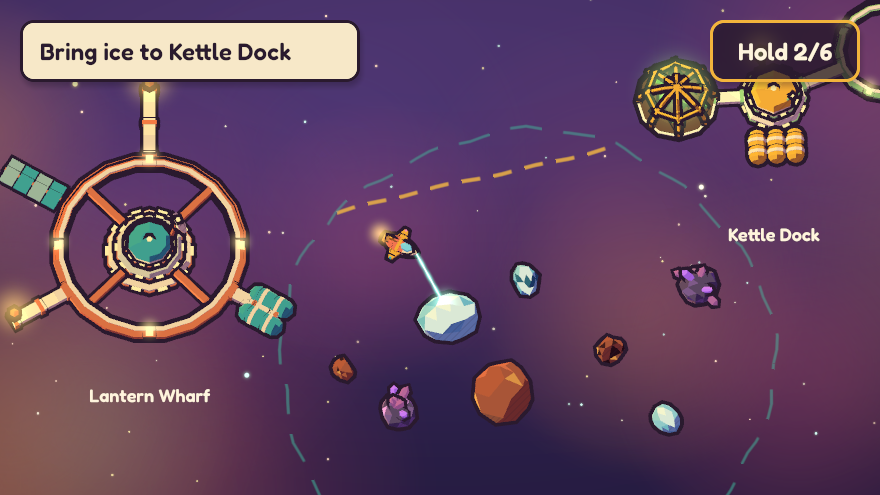
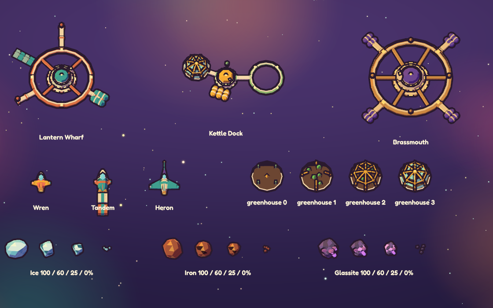

# render

The Lantern Reach renderer: a small 3D scene renderer on wgpu with a cel-shaded,
ink-outlined look, plus `kit`, a procedural parametric mesh kit.

It depends on no sim crate. The app turns world state into a `Scene` each frame and
hands it to a `Renderer`, so the simulation never knows how anything is drawn.





## Run it

From `slices/01-lantern-reach/`:

```text
cargo run -p render --example showcase                    # window: WASD, Space mines, P pauses
cargo run -p render --example shot -- out.png             # headless PNG of the demo world
cargo run -p render --example shot -- out.png --paused    # ...with the PAUSED card
cargo run -p render --example shot -- out.png --gallery   # every kit piece, labelled
cargo test -p render                                      # CPU tests (no window, GPU or network)
cargo test -p render -- --ignored                         # GPU tests (needs an adapter)
```

`shot` also takes `--size WxH`, `--tilt DEG`, `--zoom H`, `--center X,Y` and `--time S`.
In the showcase, Q/E or the mouse wheel zoom, T toggles the tilt and F12 saves
`showcase.png`. `showcase -- --shot out.png` flies and mines on its own for two seconds,
saves a frame through the window renderer and quits.

## Conventions

- World units, right-handed, **Z up**. The overworld play plane is `z = 0`: a sim position
  `(x, y)` is world `(x, y, 0)`. In the default camera +X is right and +Y is up the screen.
- Meshes face +X: a hull's nose points along +X, so `MeshInstance::at(mesh, pos, heading,
  scale)` points it along `heading` (radians, counter-clockwise from +X).
- Rough scale used by the kit: a Wren is 6 long, a rock 2–5 in radius, Lantern Wharf about
  31 in radius. A comfortable overworld view is 80–120 units tall.
- Colours are linear `Color`s, authored as sRGB hex (`Color::hex(0xf2c14e)`) and stored as
  `"#f2c14e"` in serde.
- The renderer never reads a clock. `Scene::time` drives shader animation (beam shimmer);
  pass a fixed value for repeatable shots.
- Overlay coordinates are logical pixels, top-left origin. `Renderer::logical_size()` is
  the viewport to pass to `Camera::world_to_screen` / `screen_to_plane`.

## Public API

```rust
use render::{Camera, Color, Renderer, Scene, MeshInstance, Material, Line, Glow,
             Panel, Rect, Text, Align, PausedCard, PointLight};
use render::kit::{self, HullParams, RockKind, RockParams, StationRecipe};

// Window (winit 0.30) or headless.
let mut r = Renderer::new_windowed(window.clone())?;     // then r.resize(w, h) on Resized
let mut r = Renderer::new_headless(1280, 720)?;           // for `galaxy shot`

// Upload once.
let wren = r.upload_mesh(&kit::hull(&HullParams::wren(), seed));
let wharf = r.upload_mesh(&kit::station(&StationRecipe::lantern_wharf()));
let sky = r.upload_backdrop(&kit::backdrop(&kit::BackdropParams::default(), seed));

// Every frame.
let mut scene = Scene::new(Camera::top_down(center, 100.0).with_tilt(20.0));
scene.backdrop = Some(sky);
scene.meshes.push(MeshInstance::at(wren, ship_pos, heading, 1.0));
scene.lines.push(Line::path(points, 1.0, color).dashed(3.5, 2.5).wobbly(0.5));
scene.lines.push(Line::beam(from, to, 1.6, Color::hex(0x7ff0d8)));
scene.overlay.texts.push(Text::new("Bring ice to Kettle Dock", pos, 24.0).weight(600));
scene.overlay.paused = paused.then(PausedCard::default);
r.render(&scene)?;                                       // window: draw and present
let png = r.render_to_rgba(&scene)?.encode_png()?;       // any renderer: read back
```

| Item | What it is |
|---|---|
| `Renderer` | `new_windowed(Arc<Window>)`, `new_headless(w, h)`, `resize`, `set_scale_factor`, `logical_size`, `upload_mesh` / `update_mesh` / `remove_mesh`, `upload_backdrop`, `measure_text`, `render`, `render_to_rgba` |
| `RgbaImage` | `width`, `height`, `pixels` (sRGB RGBA8), `pixel`, `encode_png`, `save_png` |
| `Scene` | `camera`, `lights`, `clear_color`, `backdrop`, `meshes`, `lines`, `glows`, `overlay`, `time` |
| `Camera` | `top_down(center, view_height)`, `.with_tilt(deg)`, `perspective(eye, target, fov)`, `view`, `projection`, `view_proj`, `world_to_screen`, `screen_ray`, `screen_to_plane`, `world_per_pixel` |
| `Lights` | key `sun_direction` / `sun_color`, `ambient`, `rim`, up to 8 `PointLight`s |
| `Material` | `tint`, `shadow`, `highlight`, `bands` (2 or 3), `outline`, `outline_px`, `emissive`, `hatch` (serde) |
| `Line` | `path`, `circle`, `beam`, `.dashed(dash, gap)`, `.wobbly(amplitude)`, width in world units |
| `Overlay` | `panels: Vec<Panel>`, `texts: Vec<Text>`, `paused: Option<PausedCard>` |
| `MeshBuilder`, `MeshData` | build your own flat-shaded meshes (`cuboid`, `lathe`, `frustum`, `torus`, `extrude`, `quad`, `tri`) |
| `palette` | the warm swatches (`INK`, `PARCHMENT`, `CORAL`, `MUSTARD`, `TEAL`, `LANTERN`, ...) |
| `demo` | sample code: a `DemoWorld` mapped to a `Scene`, and `gallery()` |

### The kit

All generators are CPU-side, deterministic for a seed and unit tested.

- `kit::hull(&HullParams, seed)`: `HullParams::wren()`, `tandem()`, `heron()` or any
  params (length, width, height, nose, wing span and sweep, engines, cargo pods, fin, mast,
  facets, colours, and a `mark`). Out-of-range values are clamped. Every hull has a dorsal
  stripe and a tail pennant. The Wren adds cheek pods, the Tandem a box cab, the Heron
  canards and a wide mast dish. `mark` is `lantern_kettle`, `toll_key`, `open_lamp`, or
  empty; the Wren preset carries the kettle.
- `kit::rock(&RockParams { kind, radius, remaining }, seed)`: ice, iron or glassite. As
  `remaining` drops the rock shrinks (`kit::rock_scale`), gets planar chips with a warm
  bitten face and inked cracks, and glassite loses crystals; at 0 it is a few pebbles with
  warm caps. The same seed keeps the same rock. Re-mesh with `update_mesh` when `remaining`
  crosses a visible step (the demo uses 1/20).
- `kit::station(&StationRecipe)`: a station is a serde recipe of parts, a palette and
  decals (`stripe`, `chevron`, `sigil`, `number`). `StationRecipe::validate()` reports
  every problem with its part index; `validate_art` checks the recipe against
  `assets/art-bible.toml`. `kit::station_lights` gives lantern and beacon positions for
  glows and point lights; `kit::docking_ring_center` finds the ring. Presets:
  `lantern_wharf()`, `kettle_dock(stage)` (greenhouse stages 0–3), `cinder_hook()`,
  `glass_drift_observatory()`, `brassmouth()`.
- `kit::backdrop(&BackdropParams, seed)`: a quiet gradient, a few nebula clusters and sparse
  stars on a repeating tile that scrolls with a small parallax.

A recipe a game master could write (missing fields use defaults):

```json
{
  "name": "Sixth Station",
  "palette": { "hull": "#f0d9b5", "accent": "#c2577a" },
  "parts": [
    { "part": "hub", "radius": 5, "height": 4 },
    { "part": "arm", "length": 8, "width": 2, "at": { "angle": 45, "distance": 5 } },
    { "part": "greenhouse", "radius": 4, "stage": 2,
      "at": { "angle": 45, "distance": 17 }, "color": "#8fbf7a" },
    { "part": "docking_ring", "radius": 10 }
  ]
}
```

Part kinds: `hub`, `docking_ring`, `arm`, `greenhouse`, `antenna`, `tank`, `sail`,
`lantern`, `lens`, `cargo_pod`, `crane`, `solar_petal`, `lamp_mast`, `dome`, `habitat_ring`,
`beacon`, `signage`, `antenna_cluster`, `docking_arm`, `banner`, `arch`, `spire`, `block`,
`scaffold`.
`at` is `{ angle (deg), distance, z, turn (deg), scale }`; in a part's frame +X points away
from the station centre.

## How it draws

One MSAA (4x) world pass with a depth buffer, an inner-ink pass, then an overlay pass:

1. Backdrop: a vertical gradient with a soft vignette, then instanced soft nebula puffs and
   stars on repeating tiles.
2. Meshes: cel shading with 2–3 hard tone bands from a half-Lambert key light, warm violet
   shadows (never gray), a hard rim light, stepped point-light pools, screen-space hatching
   in the shadow band, and self-lit paint (vertex alpha) for windows, lanterns and engines.
3. Ink outlines: an inverted hull. Back faces are pushed out by a constant number of pixels
   along normals averaged across hard edges, so outlines don't crack at corners and keep
   their weight at any zoom. Works the same with a perspective camera. This is the
   silhouette only.
4. Inner ink: a second, non-multisampled pass writes an octahedral normal, a 16-bit view
   depth and the unlit paint into two `Rgba8Unorm` targets. A fullscreen pass then draws a
   line where neighbouring surface pixels crease harder than the art bible's angle, where
   the paint changes, or where the depth steps while the normals still agree. Pixels with
   no surface neighbour are left to the hull outline, so rocks do not become wireframes.
   `textureLoad` and plain unorm targets keep the pass the same on DX12, Vulkan and Metal.
   Widths come from `assets/art-bible.toml`.
5. Lines, beams and glows: camera-facing ribbons with soft ink-edged sides, dashes and
   hand-drawn wobble; additive beams and glows.
6. Overlay: rounded SDF panels with an ink border and soft shadow, glyphon text, and the
   PAUSED card (dimmed world, big centred card) drawn above everything.

## Assets and licences

- `assets/fonts/Fredoka-Variable.ttf`: Fredoka by Milena Brandão and Hafontia, SIL Open Font
  License 1.1 (`assets/fonts/OFL.txt`), from Google Fonts. It is the only font loaded, so
  shots look the same on every machine.
- Dependencies: wgpu, winit, glyphon (cosmic-text), glam, bytemuck, pollster, png, serde.
  All MIT or Apache-2.0 (or Zlib).
